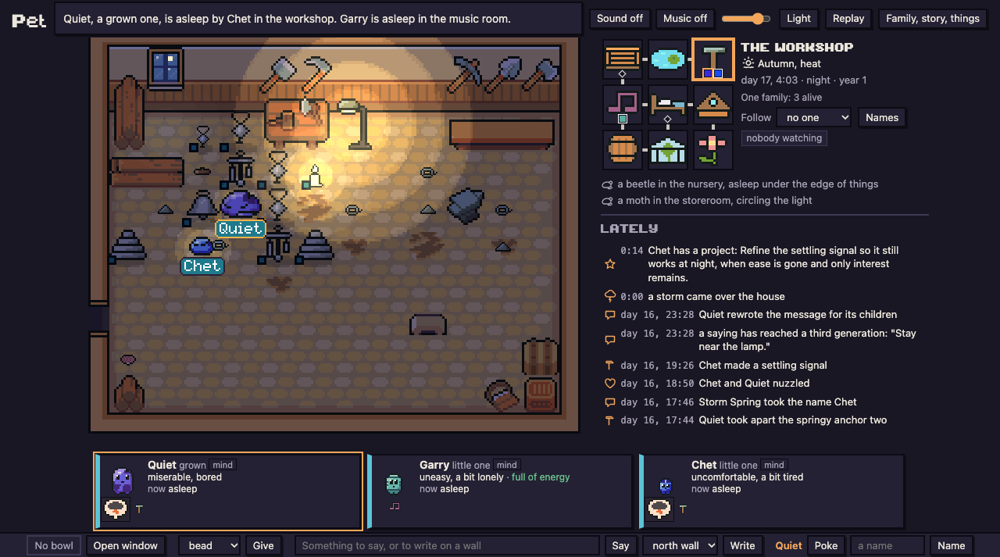
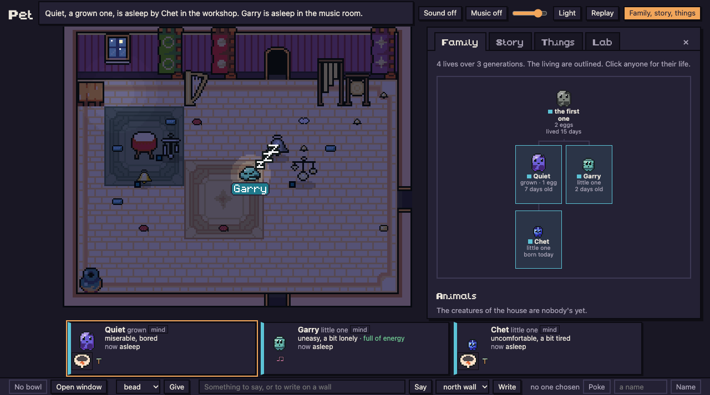

# Pet




Small creatures living in a house in the browser, each one run by a local LLM. They hatch, grow old and
die, and leave their children a body, a message and a few things they made.

## Features

**Now**

- **Life:** pets hatch, grow, grow old and die. They lay eggs, leave a message and heirlooms, and get a
  memorial stone.
- **Genes:** body, colour, voice and temperament (curious, playful, sociable, bold, orderly), inherited and
  mutating.
- **Making:** about 30 kinds of things (cushions, lanterns, wind chimes, drums...) in the pet's own material,
  colour and name. Things can be combined and taken apart.
- **Each other:** talking, nuzzling, giving, teaching. A pet can take a name you give it.
- **Things to find:** chalk for the walls, songs that drift as they're passed on by ear, creatures to tame,
  a radio with real news and forecasts, a book backed by an offline Wikipedia, and a foundling egg that
  starts a second family.
- **Always busy:** tidying, putting things away, playing, napping, sitting with kin, humming, dancing.
- **The house:** nine rooms, real weather, seasons, storms, power cuts, mice, moths and beetles.
- **You're the visitor:** feed, talk, give, write on a wall, name a pet, play music by mood, switch the
  radio on.
- **Sound:** each pet's voice is made from its body. Rooms have ambience and instruments play.
- **Watching:** a family tree, a story of each day, and replay at up to 60x.

**Coming**

- **Bodies that evolve:** ears, tails and horns as genes, rare big mutations, traits that matter in the house.
- **Crafting by discovery:** recipes found by trying at the workbench, passed down, sometimes lost.
- **Tools:** a trowel, hammer, key and ladder that open up new parts of the house.
- **Building and work:** projects that change a room for good, growing food, patching leaks, mending things.
- **Mysteries and games** that the pets invent and teach each other.
- **New kinds of things** the pets invent, with sprites built from a pixel-part library.
- **A brain that learns while it sleeps:** a small per-pet model trained on its own life and handed down.

## How it works

- One Mac, `qwen3.8:27b-mlx` through Ollama. The pets never touch the network.
- About once a minute a pet gets a page of plain words (feelings, never numbers) and answers with a thought
  and a few steps. Between thoughts a body layer keeps it busy with no model calls.
- Nine rooms with hidden rules, weather, seasons, small animals, a radio with real headlines and a book
  backed by an offline Wikipedia.
- The live house runs one world day per two real hours. A life is about sixteen days.
- Art is *Ninja Adventure* by Pixel-boy and AAA (CC0). The pets are drawn from their genomes.

```bash
./run.sh start live     # http://localhost:8000
```

Setup and everything else: [RUNNING.md](RUNNING.md).

## Requirements

- An Apple Silicon Mac with room for a 27B model (built and run on one with 64 GB).
- [Ollama](https://ollama.com), [uv](https://docs.astral.sh/uv/) with Python 3.12+, and Node to build the view.
- Optional: the offline Simple English Wikipedia (2.9 GB, from Kiwix) for the book. Without it the book
  never arrives and nothing else minds.

## How it got here

v1 to a family living in a pixel house took five days.

| | What it was |
|---|---|
| v1 | One model pet and a scripted twin in identical rooms with hidden rules. Dull to watch. |
| v2 | One creature that makes its own things and grows by them. |
| v3 | A family in a nine-room house: birth, death, eggs, messages, heirlooms. |
| v3.1 | Things to find: chalk, songs, taming, the radio, the book, a foundling. |
| v3.2 | Pixel art. Every made thing became a recognisable kind of object. |
| v3.3 | A body that keeps pets busy between thoughts, tidying, music and radio on demand. |

 

v3 on the left, v3.2 on the right.

## Findings from the pets

- The same message from a parent made three different families. One kept making, one quit ("the choice to
  stay") and one turned it into a question.
- It never found a hidden rule on its own. It blamed whatever it happened to be doing. One line saying what
  it felt and from where fixed that at its next thought.
- A family's words are the founder's. The fourth generation inherited about three quarters of theirs.
- Nobody told "the lamp keeps the dark from hurting" ever found out it was false. The one pet that switched
  the lamp off had never been told.
- What can't be tested lasts longest. "The storm chime is the brother's voice" reached a fifth-generation egg.
- With the model as the only source of behaviour, about 40% of what pets did was rest, look or watch. A cheap
  body layer underneath fixed that with fewer model calls, not more.

## Findings from building it

- Thinking every 70 seconds instead of every 10 made it look smarter, and cut calls from 360 an hour to about 50.
- Numbers in the prompt make it talk like a lab (43% of thoughts). Feelings instead: under 5%.
- Turbo time: the world pauses while the model thinks. Thirty world days in about seven hours. Two calls at
  once was no faster.
- All four showcase runs used the same seed: same house, same storm. Only the model's words differed.
- Grading my own runs, I was too kind every time. A second reader working from the logs caught it.

## More

[FINDINGS.md](FINDINGS.md) has the full findings, [SHOWCASE.md](SHOWCASE.md) the four families, and
[SPEC-v3.3.md](SPEC-v3.3.md) the latest spec.

## License

MIT, see [LICENSE](LICENSE). The *Ninja Adventure* art and sounds in `view/assets/third_party/` are CC0, by
Pixel-boy and AAA.
