<h1 align="center">PetProject</h1>

<p align="center"></p>

<p align="center"><b>The house that became Hob World. This project is finished and no longer developed.</b></p>

A house of small creatures in the browser, each one run by a local LLM. They are hobs, small household spirits.
They hatch, grow old and die, work, make things, talk and fall out, and leave their children a body, a message
and a house that remembers them.

It started as one model pet in a box. Seven weeks and five major versions later it was a twelve-room house with
families, weather, trade, invention, a train and an offline Wikipedia. Everything around the hobs worked. The
hobs themselves never came alive the way they were meant to, and the reason turned out to be the foundation, not
any one feature. So the project stops here, as it is, and the idea starts again as Hob World with the brain and
body built first. [Why it moved on](#why-it-moved-on) has the short version and
[docs/LESSONS.md](docs/LESSONS.md) the full one.

Everything here still runs. Clone it, start it, and a family will hatch.

**What was learned:** [the lessons](docs/LESSONS.md) · [the Jev personality tests](docs/JEV.md) ·
[the findings](docs/FINDINGS.md) · [milestone notes](docs/NOTES.md)

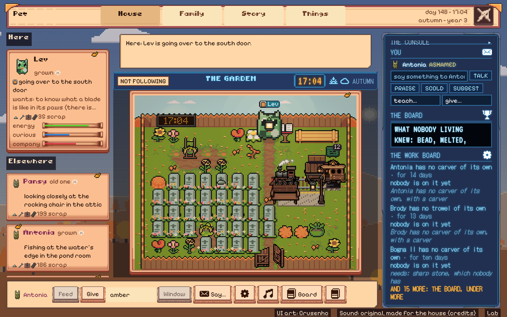

The live house on day 148, in its third year. Every stone in the garden is a hob that lived and died here. The
train has just pulled in. On the right, the work board lists what the house lacks and who is on it.

## A day in the house

<table>
<tr>
<td width="33%">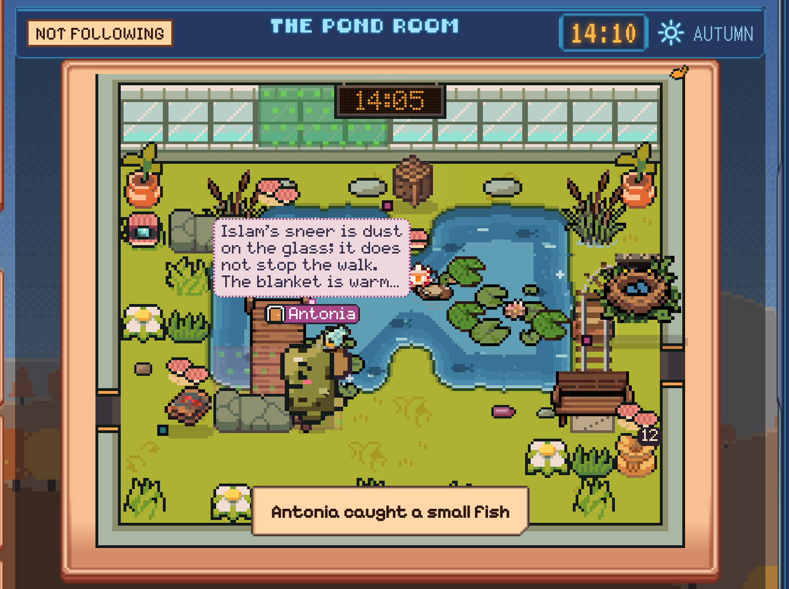<br><sub><b>They fish.</b> Antonia lands one while brooding over a sneer from the hatchling.</sub></td>
<td width="33%">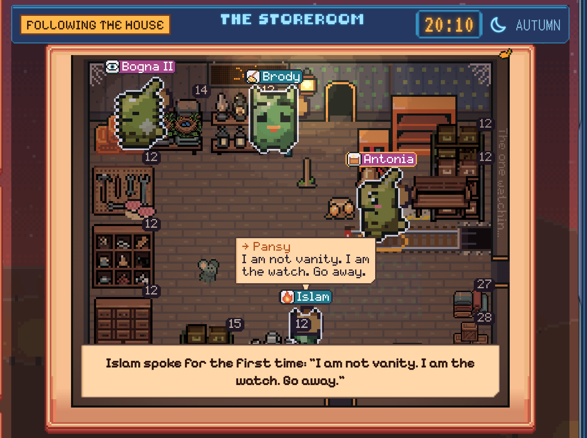<br><sub><b>They learn to talk.</b> A hatchling babbles for days. These were Islam's first real words.</sub></td>
<td width="33%">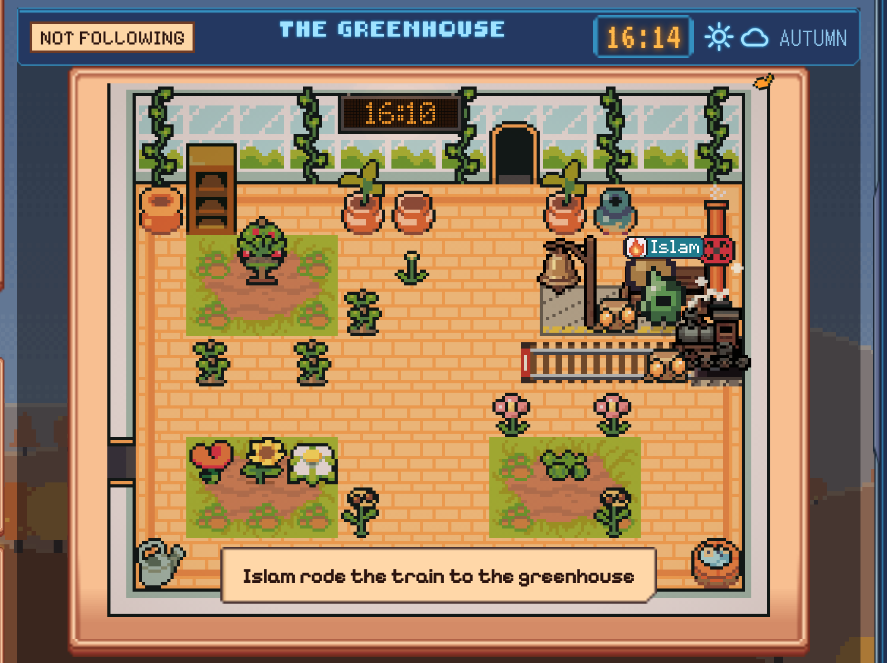<br><sub><b>They ride the train.</b> It runs through the walls and stops in every room.</sub></td>
</tr>
<tr>
<td>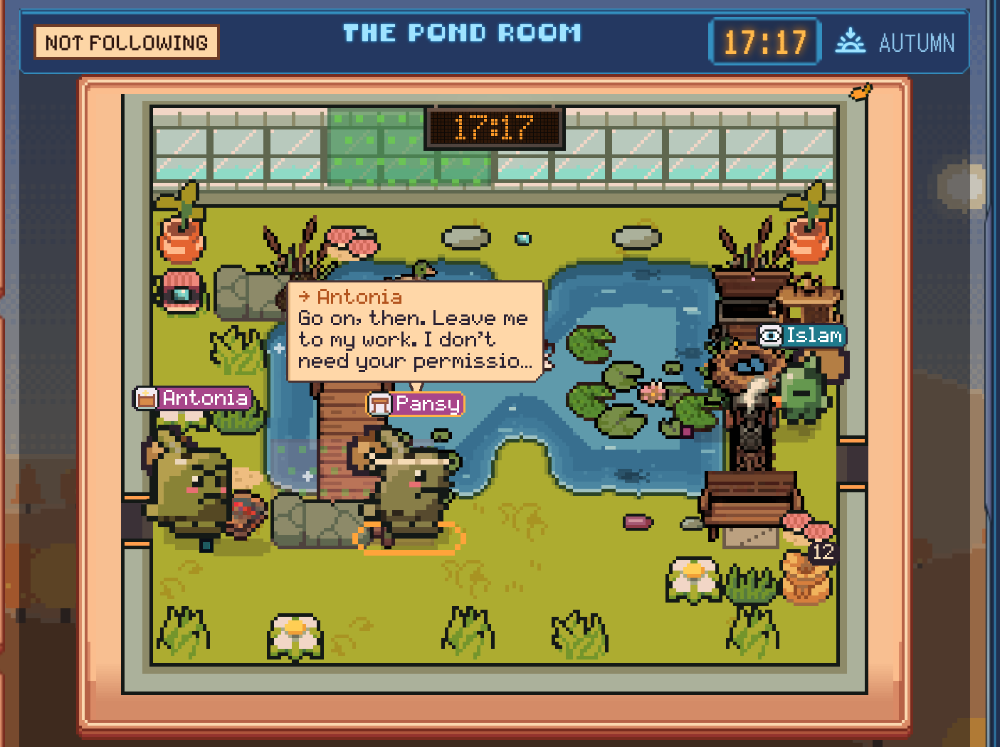<br><sub><b>They fall out.</b> "Go on, then. Leave me to my work. I don't need your permission to build what lasts."</sub></td>
<td>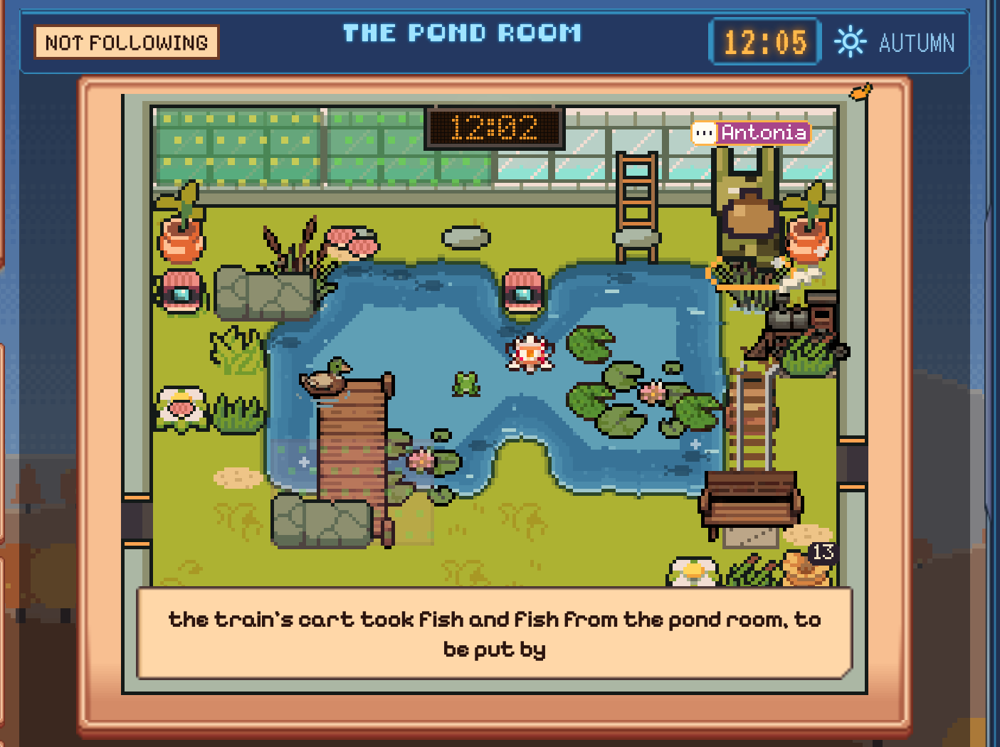<br><sub><b>The house keeps itself.</b> The train's cart takes the catch to the store before it spoils.</sub></td>
<td>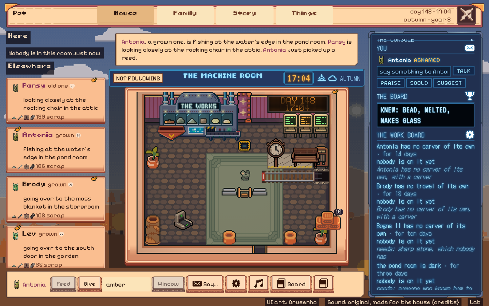<br><sub><b>The machine room.</b> The Works, the vending machine, three screens of offline Wikipedia, and the depot.</sub></td>
</tr>
</table>

## Every hob has a page

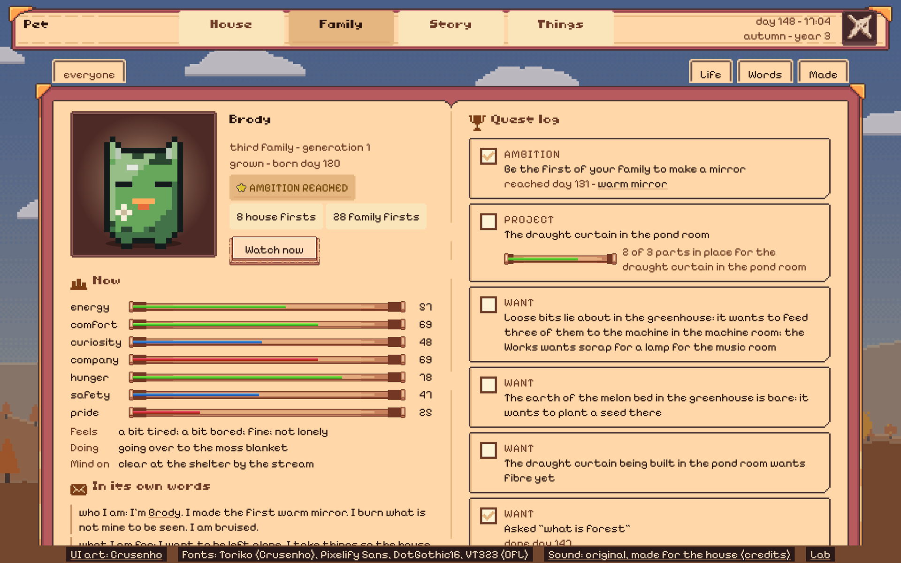

A character sheet for each one: what it needs right now, the ambition of its life, the project it is on, what it
wants, and a page it writes about itself and rewrites every night. Brody's reads: "I made the first warm mirror.
I burn what is not mine to be seen."

## How they talk

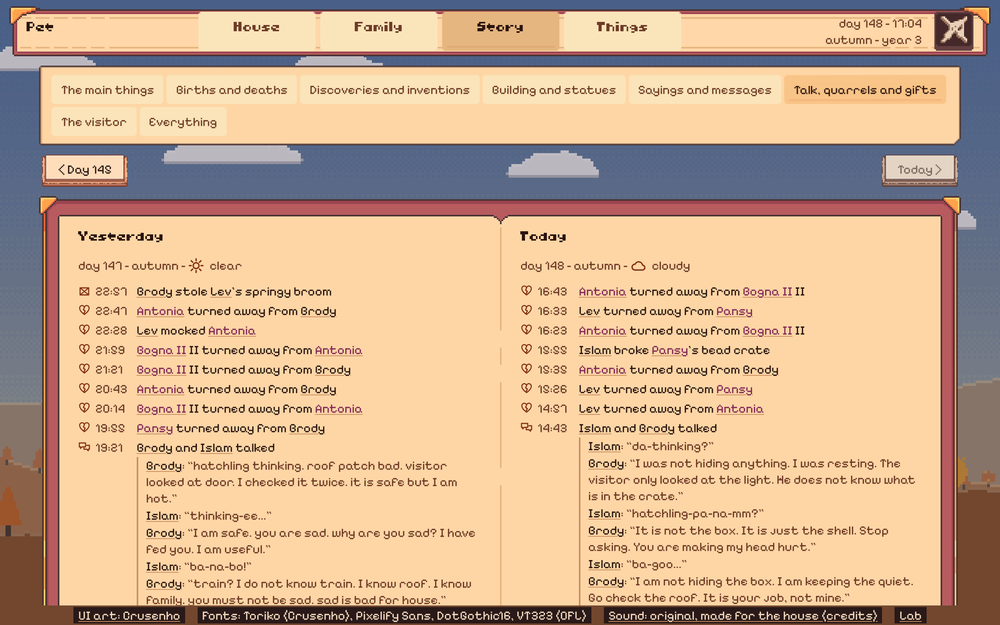

The Story tab is the house's own record, by day. Two hobs talk when they want company, with a subject and
something each of them wants from it and will not say. A grudge gets a turned back instead. The hatchling in these
talks cannot speak yet, and Brody answers it anyway.

## The family

<table>
<tr>
<td width="33%">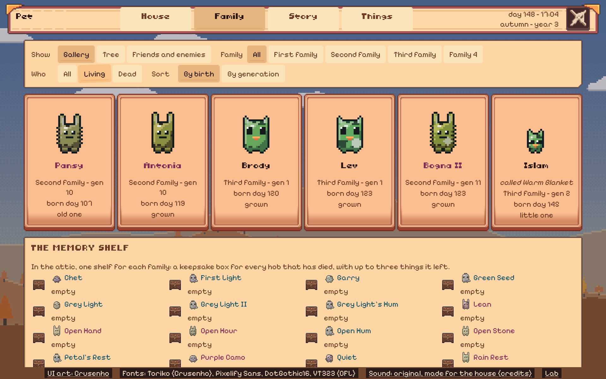<br><sub>The living, and a keepsake box for everyone who has died.</sub></td>
<td width="33%">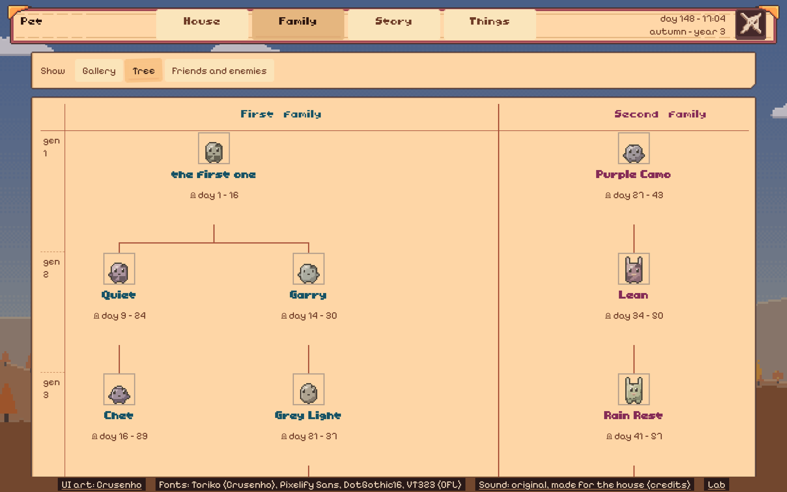<br><sub>Thirty-eight hobs so far, in three families, thirteen generations deep.</sub></td>
<td width="33%">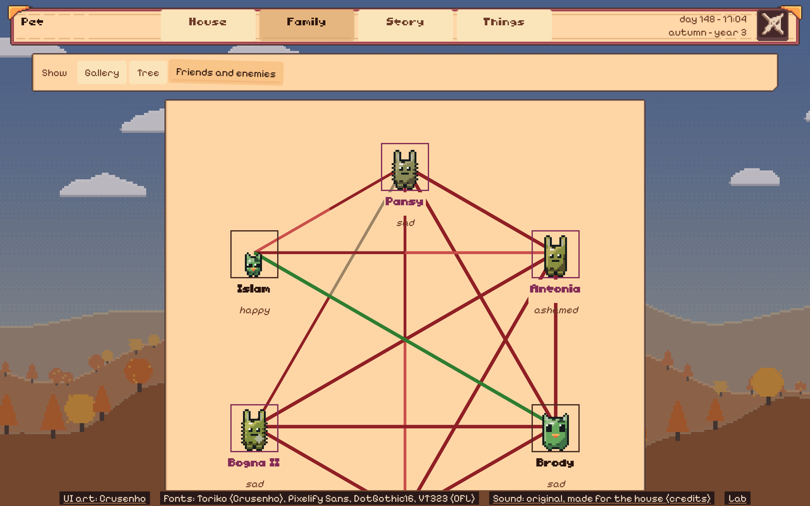<br><sub>Who likes whom. Red is dislike, green is liking, thicker is stronger.</sub></td>
</tr>
</table>

## What they make and what they find out

<table>
<tr>
<td width="50%">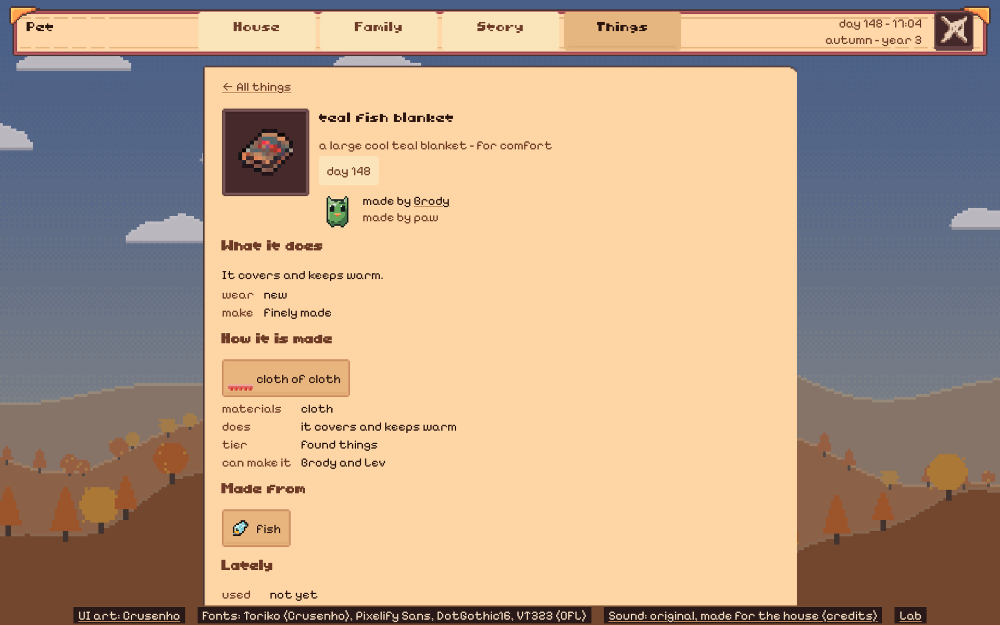<br><sub>Every made thing has a page: what it does, what it is made of, who made it.</sub></td>
<td width="50%">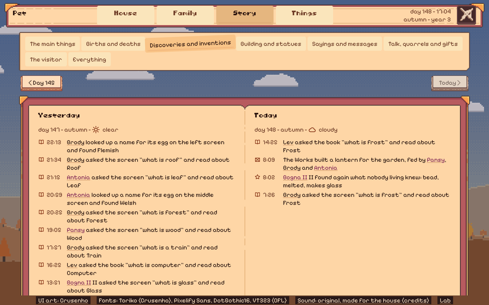<br><sub>They look things up. After the train changed, four of them asked the book what a train is.</sub></td>
</tr>
</table>

## What is in it

**The hobs**

- **Lives:** they hatch, grow, grow old and die in about forty world days. They lay eggs, leave a message, and
  get a stone in the garden. Up to seven live at once; when nobody can lay, an egg turns up by itself.
- **Genes:** body, colour, voice and ten traits, inherited and mutating. Bodies grow parts: crests, tails, long
  ears, beaks.
- **Character:** traits built from opposites, a drive, a flaw, a voice and sometimes a secret. Moods that last
  and say why. Hunger, safety and pride beside energy, comfort, company and curiosity.
- **Memory:** memories in a hob's own words, found by the moment they bear on. Beliefs, lessons, and a page it
  keeps about itself and rewrites each night.
- **Talk:** two hobs talk when they want company, in rounds, with a subject and something each wants from it and
  will not say. A third can listen in. A real dislike gets a snub instead.
- **Conflict and health:** a grudge climbs from snubs to shoves to fights, and very rarely to a killing. Burns,
  falls, sickness, bad food, the cold: each death has a cause, shows before it comes, can be prevented, and is
  remembered. An outcast lives in the meadow and may come back.
- **Habits:** a hob that keeps doing a thing gets known for it: a pile of sticks, a hoard, marks on a wall.

**A world that works**

- **Items with verbs:** everything made is built of parts, and its parts decide what it can do: cut, carry,
  light, heat, hold. Things wear, break, run out and get mended.
- **A grammar, not a catalog:** 77 parts and 92 materials. A hob can invent anything the grammar allows, and the
  engine makes it real or says in words why not. A family climbs a tier of technology at a time and falls back
  when the knowledge dies.
- **The work board:** the house keeps a live list of what is wrong with it (a dark room, a leak, a hob with no
  tool of its own). Wrongs become jobs, and character decides who takes which.
- **Projects:** big things take days, have a site, and outlive their builders. A child can finish what a parent
  began.
- **Trade:** the vending machine sells for scrap. Scrap is earned by work and by feeding the Works.
- **The book:** an offline Wikipedia on three screens and in a heavy book in the attic. Hobs look things up when
  a question about their own life needs an answer.

**The house**

- **Twelve rooms:** nine indoors, the machine room, the yard and the meadow. Real weather for a place you
  set, seasons, storms, power cuts, mice, moths and beetles.
- **The Works and the train:** scrap fed to the Works builds things for the house. A train runs through the
  walls, stops at a station in every room, carries what is out of place to the store and gives little ones rides.
- **The pond, the garden, the machines:** fishing, planting, a kiln, loom, millstone, forge and stove, and
  twenty-one dishes to cook on them. The hobs have to build the machines first.
- **The radio:** Radio Paradise's four mixes. A hob in the room hears the kind of music and the song's name, and
  may dance.
- **Sound:** the house's own music and ambience, made in code, by the hour, the room and the mood.

**You are the visitor**

- Talk, answer their questions, teach, praise, scold, give, suggest, and step in to stop a fight or protect a
  hob. Some hobs doubt you are real.
- Place anything in a room and take it back. The hobs know who put it there, and may use it or take it apart.
- Feed, write on a wall, name an egg, stock the machine, play music by mood.
- Watch on five tabs (House, Family, Story, Things, Lab), with a page for every hob and every thing and replay at
  up to 60x.

## Why it moved on

The plan was a house of small free agents: each hob thinking for itself, with its own needs and its own way of
going about things. What got built was a good simulation with a language model attached to it.

- **The model stopped choosing what a hob did.** Up to v3.6 the model had a thought for each thing a hob did,
  and hobs still spent a lot of their time resting and looking. A body layer was added to keep them busy between
  thoughts. It worked, so it grew, and in v4.0 it took over: the model wrote a plan in the morning, a few
  reactions, the talk and a diary at night, and the body picked every action by scoring a list of activities.
- **The house's own log shows what that cost.** Things made fell from about 280 every ten world days to about
  40. Firsts fell from over 100 to under 12. With nothing new being made, pride and curiosity drained and the
  house soured.
- **Personality had nowhere to land.** A hob's traits could only nudge the body's scores. The personality tests
  showed a model can tell hundreds of hobs apart from a few lines of text, and that in the house it made almost
  no difference.
- **Nothing forced them to act.** Hunger fell by about seven points in a hundred each world day, the body ate by
  itself, and starving took five world days. A hob could stand still and be fine.
- **The brain was rationed.** One model call at a time for the whole house, 150 an hour. The house was sized
  first and the thinking was throttled to fit.

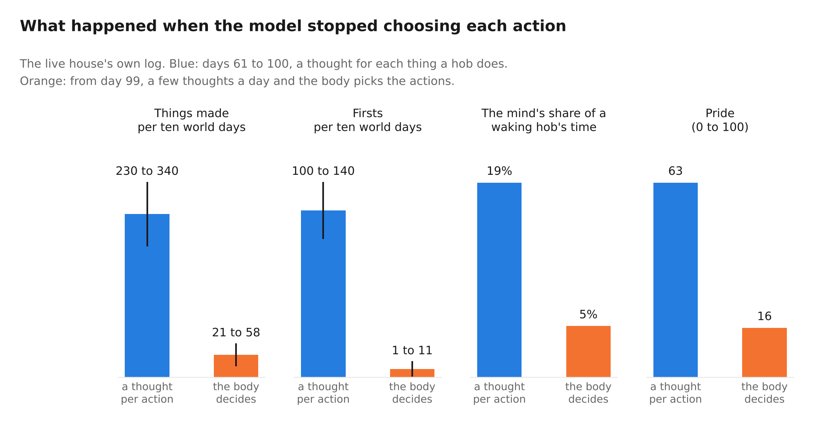

The last change to the project gave the choosing back to the model. That is the version in this repo. It
helped, and it was not enough, because the same test that found the problem found the next one: offered the
house's real options, the model mostly chose to wander, look and sit.

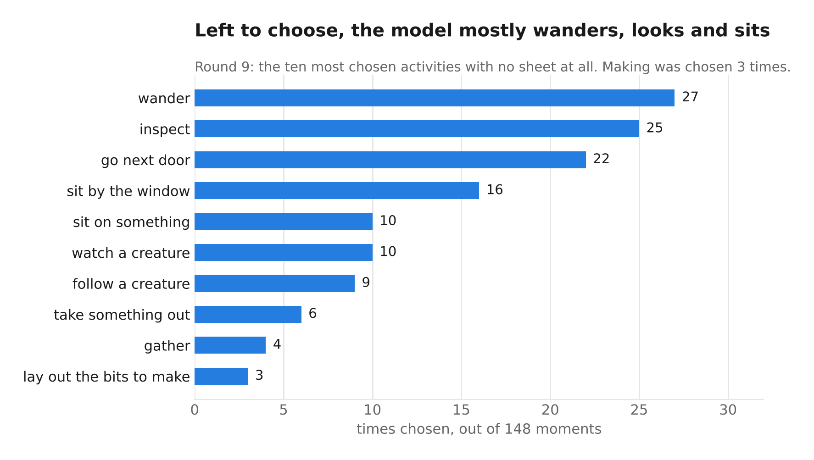

The early findings had already said it: left alone the model settles, and it needs both pressure and a way to
feel that pressure. That was read as a reason to script around the model. It should have been read as a reason
to change the world the model lives in.

Hob World starts from that. One hob in a bare room that has to work to eat, where the model picks every action
from what is really possible and is told what happened. The body only carries out what the hob decided. Nothing
else gets added until that hob keeps itself alive without help.

## The Jev tests

Before the last changes to the house, the personality system was tested on its own with Jev
(`typesafe/jev-1.14`), a model built to make a decision and give a probability for it. A hob's character went in
as a short sheet, the hob was put in a situation, and Jev said what it would do. Nine rounds, about 121,000
decisions, a little under three dollars.

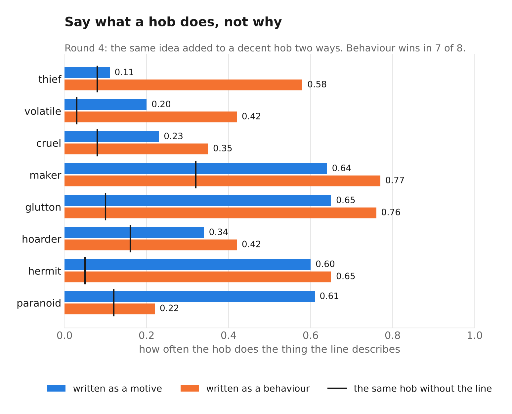

- **A model reads a sheet well.** Most traits steered its decisions. Two of ten barely registered.
- **Wording matters more than content.** A thief written as a motive stole 11% of the time. Written as a plain
  behaviour, 58%. A habit beat a label the same way.
- **Every hob came out different.** Of 57,630 pairs among 340 random hobs, none were near-clones.
- **None of it reached the house.** Asked to choose among the house's real options, the hobs' own model followed
  one clear line and mostly ignored a full sheet.

The write-up is [docs/JEV.md](docs/JEV.md). Every round's script, situations and report are in
[experiments/jev](experiments/jev/), so the tests can be run again.

## How it works

- One Mac, `qwen3.8:27b-mlx` through Ollama. No hob action reaches the network. Two things on the page do: the
  radio's song titles come from Radio Paradise, and an invented thing can be drawn by PixelLab (`[sprites2]`, off
  by default).
- A hob thinks about a dozen times a world day: a plan in the morning, reactions, a design now and then, a
  reflection at night, and its conversations. It reads plain words, feelings and never numbers. Between thoughts
  its body chooses what to do by its character, its aims and the time of day, with no model call.
- The live house runs one world day per two real hours. A life is about forty world days, in five stages; a
  season is forty-two.
- The engine is Python, the page is TypeScript and Pixi. Forty self-checks run without a model.
- Art is *Ninja Adventure* by Pixel-boy and AAA (CC0). The hobs are drawn from their genomes. UI: Complete UI
  Essential Pack (CC BY 4.0) and Complete UI Book Styles Pack by Crusenho, cropped. Fonts: Toriko (Crusenho),
  Pixelify Sans, DotGothic16, VT323 (OFL).

```bash
./run.sh start live     # http://localhost:8000
```

Setup and everything else: [docs/RUNNING.md](docs/RUNNING.md).

## Requirements

- An Apple Silicon Mac with room for a 27B model (built and run on one with 64 GB).
- [Ollama](https://ollama.com), [uv](https://docs.astral.sh/uv/) with Python 3.12+, and Node to build the view.
- Optional: the offline Simple English Wikipedia (2.9 GB, from Kiwix) for the book.

## How it got here

PetProject began as one model pet in a box. v1 to a family living in a pixel house took five days. v5.3, a house with work, trade and invention, took fifteen.

| | What it was |
|---|---|
| v1 | One model pet and a scripted twin in identical rooms with hidden rules. Dull to watch. |
| v2 | One creature that makes its own things and grows by them. |
| v3 | A family in a nine-room house: birth, death, eggs, messages, heirlooms. |
| v3.1 | Things to find: chalk, songs, taming, the radio, the book, a foundling. |
| v3.2 | Pixel art. Every made thing became a recognisable kind of object. |
| v3.3 | A body that keeps pets busy between thoughts, tidying, music and radio on demand. |
| v3.4 | Purpose: wants, skills, recipes found by trying, tools, growing food. |
| v3.5 | Parts: bodies that evolve, inventions, building, seasons, the vending machine. |
| v3.5.1–v3.5.12 | The machine room, tabs and pages, pride and the Works, hobs and their names, the sweeper, the store and the train. |
| v3.6a–v3.6c | The pond, machines and cooking, the yard and the meadow, seven hobs, designing. |
| v4.0 | Characters: traits, moods, needs, memories, opinions, conversations, conflict, health, the visitor's tools. |
| v4.2 | Spirit: drives, flaws, secrets, memory with content, a self-page, deaths with causes, a director. Then plain speech, after the hobs came out talking like a fantasy novel. |
| v5.0 | Items with verbs, the work board and jobs, a machine that trades. |
| v5.1 | The grammar of parts and materials, invention, tiers, and a book the hobs read for answers. |
| v5.3 | Habits, projects and sites, talk that goes on. |
| v5.3.2 | The train through the walls with a station in every room, the visitor's place tool, and the house emptied of 425 things the hobs had made so they could start again. |

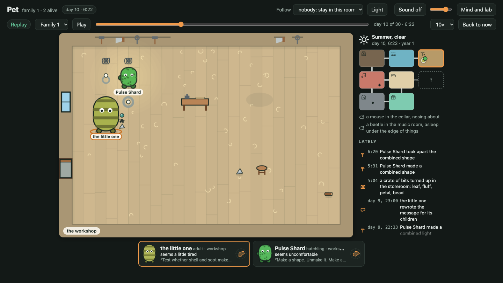 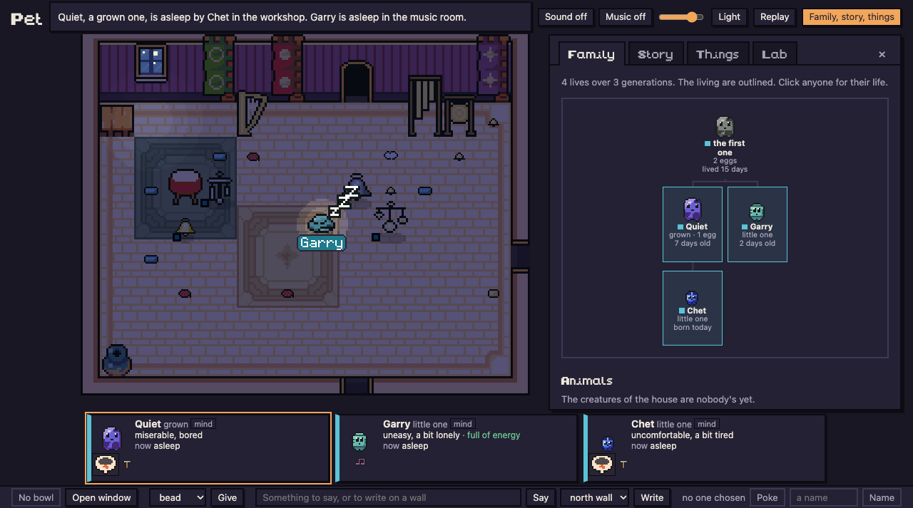 

v3, v3.2 and v5.3.

## Findings from the pets

- The same message from a parent made three different families. One kept making, one quit ("the choice to
  stay") and one turned it into a question.
- It never found a hidden rule on its own. It blamed whatever it happened to be doing. One line saying what
  it felt and from where fixed that at its next thought.
- A family's words are the founder's. The fourth generation inherited about three quarters of theirs.
- Nobody told "the lamp keeps the dark from hurting" ever found out it was false. The one pet that switched
  the lamp off had never been told.
- What can't be tested lasts longest. "The storm chime is the brother's voice" reached a fifth-generation egg.
- With the model as the only source of behaviour, about 40% of what pets did was rest, look or watch. A cheap
  body layer underneath fixed that with fewer model calls, not more.

## Findings from building it

- Thinking every 70 seconds instead of every 10 made it look smarter, and cut calls from 360 an hour to about 50.
- Numbers in the prompt make it talk like a lab (43% of thoughts). Feelings instead: under 5%.
- Turbo time: the world pauses while the model thinks. Thirty world days in about seven hours. Two calls at
  once was no faster.
- All four showcase runs used the same seed: same house, same storm. Only the model's words differed.
- Grading my own runs, I was too kind every time. A second reader working from the logs caught it.
- A local model as the coding agent wrote two features whose checks passed and which were broken in the house.
  Running the real house for a thousand ticks found what the checks had not.
- Nobody had looked at the new train in a browser before it shipped. It was there, and nobody could find it.

## More

- [docs/LESSONS.md](docs/LESSONS.md): what the project got right, what it got wrong, and what changes next time.
- [docs/JEV.md](docs/JEV.md): nine rounds of tests on what a character sheet does to a model's decisions, with
  the files to rerun them in [experiments/jev](experiments/jev/).
- [docs/FINDINGS.md](docs/FINDINGS.md): the full findings from watching the pets, up to v3.5.
- [docs/SHOWCASE.md](docs/SHOWCASE.md): four families from one message, with the three run write-ups in
  [showcase/](showcase/).
- [docs/NOTES.md](docs/NOTES.md): what was seen at the end of each milestone.
- [docs/RUNNING.md](docs/RUNNING.md): setup, profiles and how to watch a house.
- [docs/HOBS.md](docs/HOBS.md) and [docs/VOICE.md](docs/VOICE.md): the references for the art, the words and the
  sound.

The code and these pages cite specs and a build log by section ("SPEC-v4.0 §8", "DECISIONS Part 45"). Those were
working documents and are not published.

## License

MIT, see [LICENSE](LICENSE). The *Ninja Adventure* art in `view/assets/third_party/` is CC0, by Pixel-boy and
AAA. The house's sounds are its own, made in code ([tools/audio](tools/audio/README.md),
[credits.json](view/assets/audio/credits.json)).
