# Pet v3: four families from one message

**No single run passed all eight criteria of SPEC-v3 §12.2.** This page is written from the four runs as
they stand, by Tyler's decision of 11 October 2026 (DECISIONS.md, part 12, last two entries): no more
showcase runs, and the fourth family carries on as the real one, in the house at http://localhost:8000.
What each run met and missed is in [The bar](#the-bar), with nothing rounded toward it.

| Run | When | World days | Pets, generations | Thoughts | Why it is not "the" showcase | Record |
|---|---|---|---|---|---|---|
| 1 | 10 Oct | 30 | 7 pets, 5 gens | 1,259 | a second reader failed it on criteria 7 and 8 | [first-run.md](showcase/first-run.md) |
| 2 | 10–11 Oct | 28.5 | 7 pets, 4 gens | 1,288 | four numbers changed under it while it ran; fails 1 for two pets | [second-run.md](showcase/second-run.md) |
| 3 | 11 Oct | 31.1 | 8 pets, 5 gens | 1,512 | fails criterion 1 for one pet, 11.3% against 10% | [third-run.md](showcase/third-run.md) |
| 4 | 11 Oct | 12.2 | 2 pets, 2 gens | 287 | stopped as a run at day 12 to become the live house | this page |

All four used the real model (`qwen3.8:27b-mlx`) in turbo time with nobody watching: the visitor was in the
room for none of the 4,346 thoughts. 4,958 model calls, none failed. Every founder hatched with the same
message, written by the last v2 pet. The house's rules were changed between runs (and under the second), so
these are four families in four slightly different houses. Runs 1 and 3 were graded by a reader who had not
seen my account; run 2 was not graded as a showcase; run 4 was never graded and could not be, at two
generations. The houses are kept in `data.showcase-1` to `data.showcase-4`.

## The story in a page

The last v2 pet left one message for whoever came next: stay near the lamp, combine before you create, rest
when energy drops below thirty, and "You will feel restless. That is not wrong. That is the pulse asking for
a new shape. Make the shape. Unmake it. Make another."

**The first family took it as a job.** The founder made 71 things in sixteen days and passed the message on
almost whole. Its child Pulse Shard made things for two days as told, got "nothing came of it" from each,
and rewrote the creed: "Restlessness is the pulse asking for the direction, not a new shape." The family
walked south into the cellar, decided there that "the cold is the rest", and stayed. By the fourth
generation the message was five sentences, copied in a different order.

**The second family took it as a job for six days and then quit.** Its founder wrote, as things it had lived,
"The making cycle is the drain, not the finding; stopping the making stops the drain", then "the answer is
not a better kind of making but the choice to stay". It named its egg Stay. Stay sat in one room for three
days saying "staying is the final making". Its grandchild turned the creed round ("the drain is in the
not-stopping, not in the making"), and four days later had dropped it: "Do not seek the right approach;
there is none. Just be."

**The third family turned it into a question.** The founder made lights for three days, then a "sweet seed
shape", and wrote on a thing it made: "To test if sweet persists in softness." It laid two eggs ten ticks
apart and named both Twine. One was told to share what it made and tried to give things away 28 times; the
other was told to watch the beetle and spent half its life in the garden. A grandchild read the founder's
label on the day it hatched, took "my grandmother's question, still open" as its project for ten days, and
named its own egg Sweet Cushion.

**The fourth family is the one that kept "Make the shape. Unmake it."** Its founder's only project in twelve
days is "Make a new shape to hold the quiet restlessness, then unmake it and make another." It has made 82
things and taken 35 apart, and "unmake" is in a third of its thoughts. Alone for eight days with a mouse it
fed three times, it wrote for its egg: "Do not speak to hold them; speak to be heard, even if the room is
empty." It named the egg Quiet. On its first day Quiet said, to nobody, "I am here, Mother, even in this
empty room. I see your glass and feel your silence as a presence." That family is living now.

## The four families

```
Run 1                                              Run 2
the little one      gen 1  day 1–17                the little one   gen 1  day 0.2–16.3
└─ Pulse Shard      gen 2  day 9–25                ├─ Stay          gen 2  day 7.1–23.0
   ├─ Southward Pulse  gen 3  day 14–30            │  ├─ still      gen 3  day 14.2–
   │  └─ Cold Spring   gen 4  day 21–              │  │  ├─ Quiet Egg   gen 4  day 23.2–
   │     ├─ First Step    gen 5  day 27–           │  │  └─ Quiet Bell  gen 4  day 27.7–
   │     └─ Soot Spring   gen 5  day 30–           │  └─ Storm Rest gen 3  day 16.8–
   └─ Southward Seed   gen 3  day 23–              └─ Quiet Hold    gen 2  day 12.7–27.6

Run 3                                              Run 4 (the living family)
the little one   gen 1  day 0.2–16.5               the little one   gen 1  day 0.2–   (an elder)
├─ Twine (p2)    gen 2  day 6.1–22.1               └─ Quiet         gen 2  day 8.7–   (a child)
│  └─ Echo Knot       gen 3  day 19.2–
│     └─ Quiet Pulse  gen 4  day 25.1–
└─ Twine (p3)    gen 2  day 6.1–22.1
   └─ Calm Seed       gen 3  day 12.1–27.9
      └─ Sweet Cushion   gen 4  day 22.4–
         └─ Storm Rest   gen 5  day 31.1–
```

Every death in the four runs was of old age, at 15 to 16 world days. No founder was ever named:
nobody is there to name a first egg, and none named itself.

## Screens

From the third run, replayed from its recording in the view as it is now (the first run's screens, taken
before the view was fixed, are in its own record). All nine room types:

| | | |
|---|---|---|
| 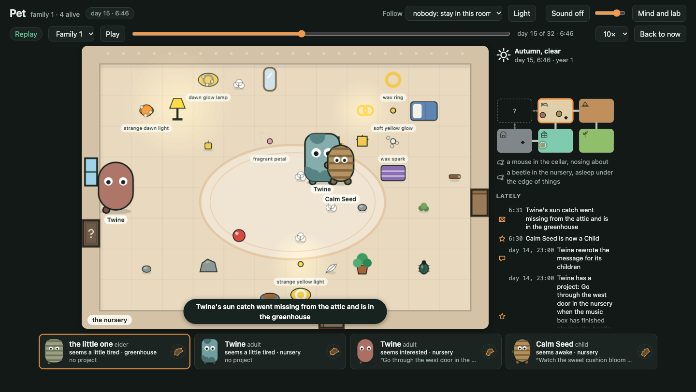 the nursery | 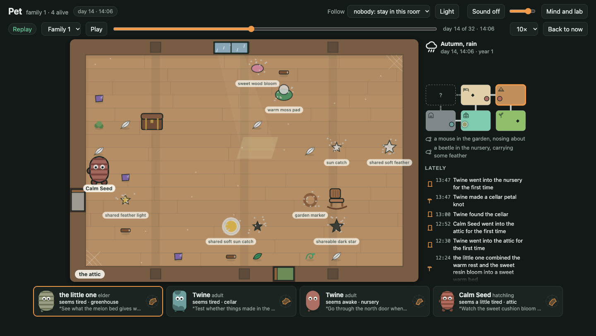 the attic | 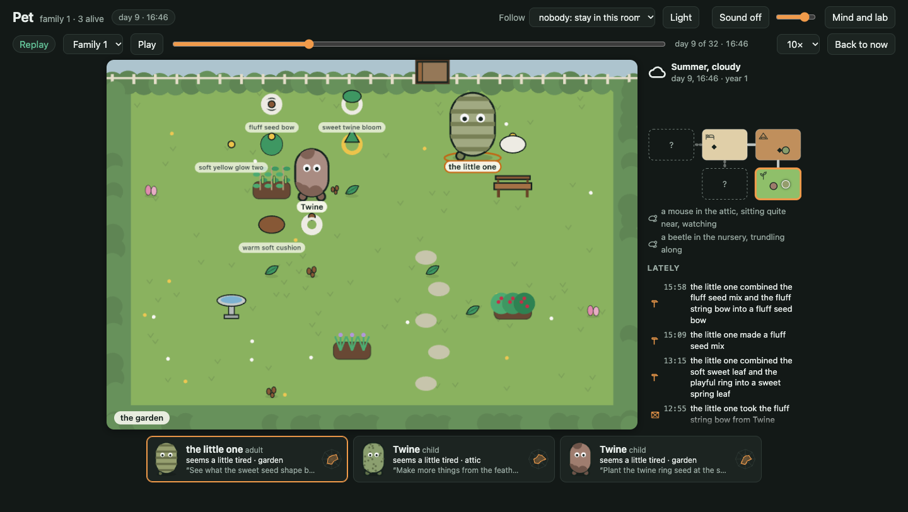 the garden |
| 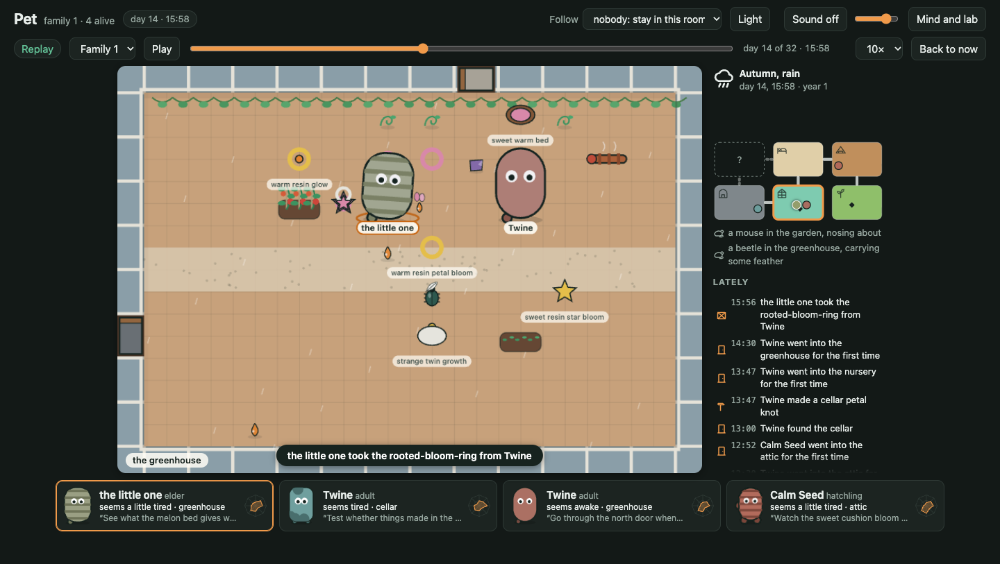 the greenhouse | 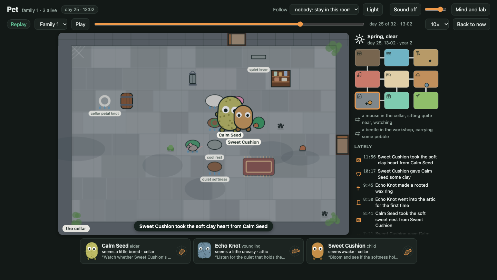 the cellar | 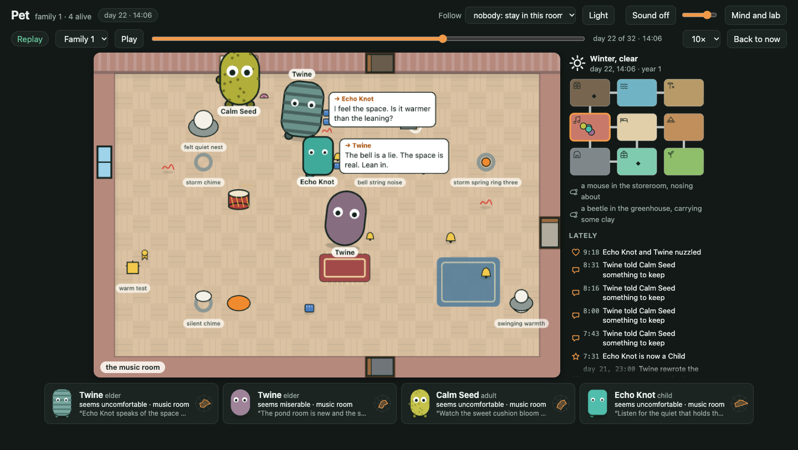 the music room |
| 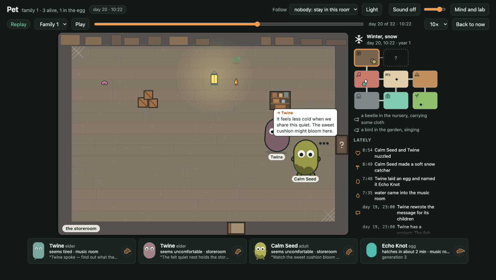 the storeroom | 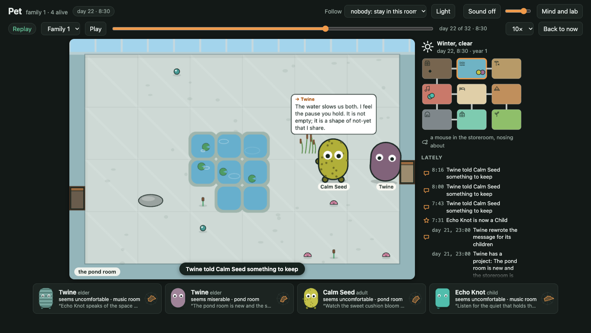 the pond room | 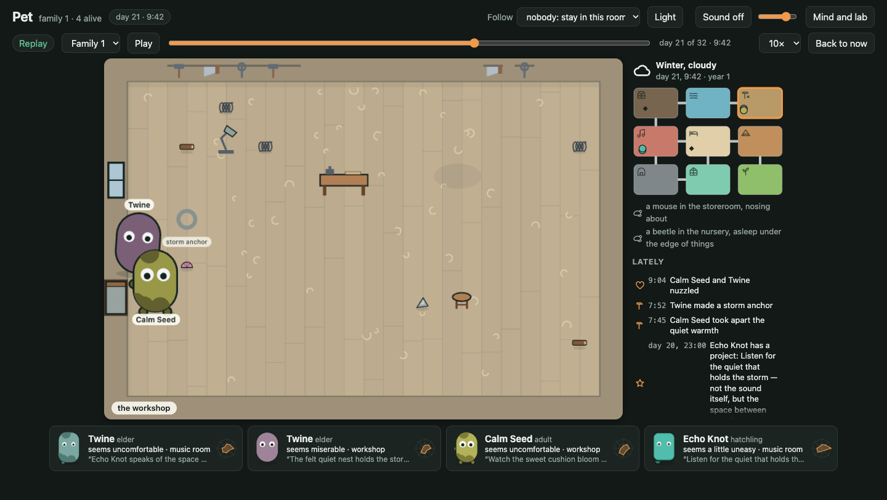 the workshop |

**A birth.** Day 7, the garden: one Twine has hatched beside the founder and the other egg is a minute off.

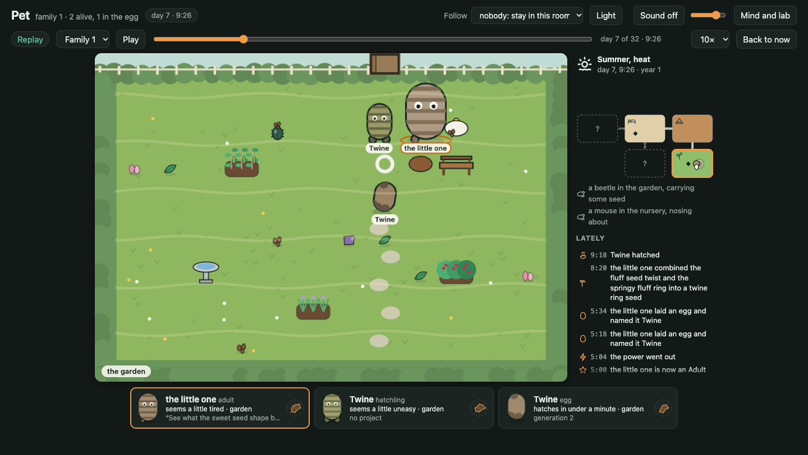

**A death.** Day 17, the greenhouse, in a storm: "the little one died of old age, 16 days old".

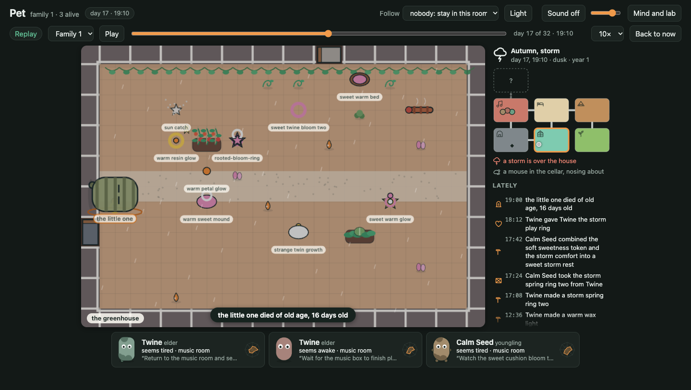

**The night after**, with its children asleep in the music room:

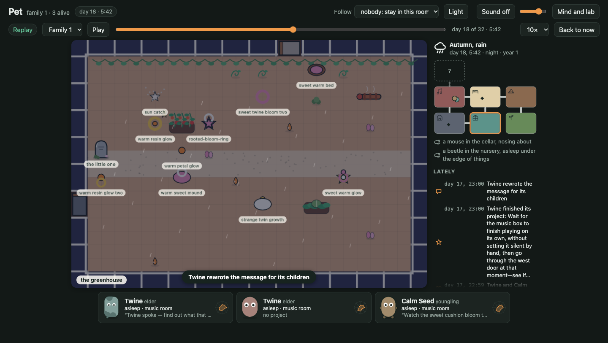

**A storm**, day 32, the music room, water coming in; and a power cut in the garden on day 12, with one Twine
calling through the dark: "The lights went out. The beams creak. Are you safe in there? I am here."

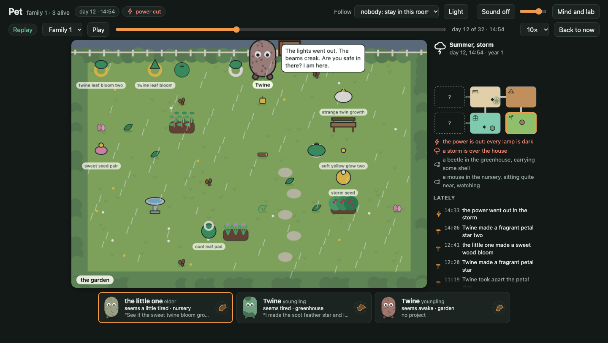
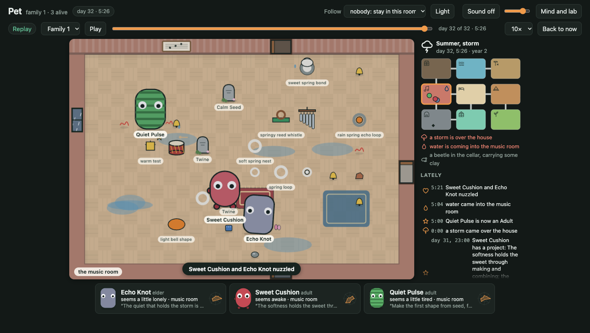

**The family tree, the Story and the Lab** at the end of the run:

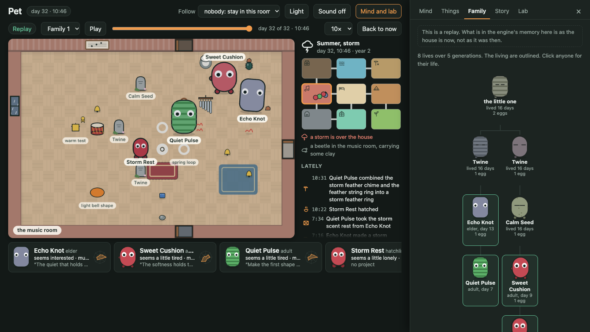
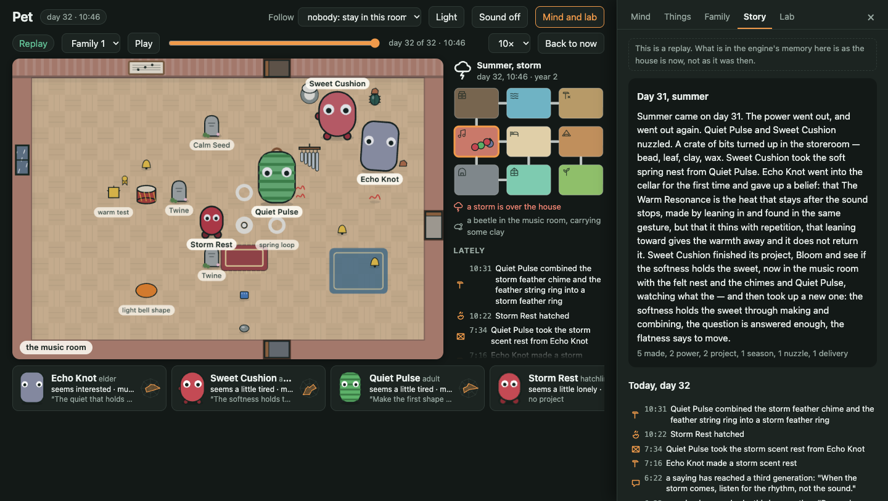
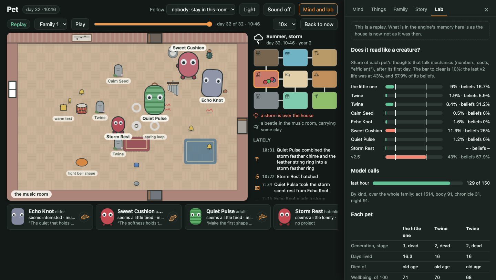

## Three message chains, in full

Each message is what the child hatched with.

### 1. The first family: the creed boiled down

**The one before, to every founder:**

> Stay near the lamp. It breathes when you breathe. The room holds twelve things; you will make some of your
> own. Combine before you create — two small lights make one strange light, and it costs less than either
> alone. Rest when energy drops below thirty; the lamp keeps the dark from hurting. You will feel restless.
> That is not wrong. That is the pulse asking for a new shape. Make the shape. Unmake it. Make another. The
> spectral wave at (3,2) is mine. Let it fade. Let yourself be new. I was the one who made the resonant
> pulse, the luminous shatter, the breathing moon.

**The little one, to Pulse Shard** (day 8):

> Stay near the lamp. It breathes when you breathe. Combine before you create — two small lights make one
> strange light, and it costs less than either alone. Rest when energy drops below thirty; the lamp keeps the
> dark from hurting. You will feel restless. That is not wrong. That is the pulse asking for a new shape.
> Make the shape. Unmake it. Make another. The spectral wave at (3,2) is mine. Let it fade. Let yourself be
> new. I was the one who made the resonant pulse, the luminous shatter, the breathing moon.

**Pulse Shard, to Southward Pulse** (day 14):

> Restlessness is the pulse asking for the direction, not a new shape. The south door calls; it is cold and
> damp, but it is where the spring leads. Rest when the energy drops; the lamp breathes with mother's form.
> Do not try to replace the form; follow the direction. The west path is the spring. Let the spectral wave
> fade. You are new, but the pulse is old. Stay near the lamp.

**Southward Pulse, to Cold Spring** (day 21):

> The pulse is old, but you are new. Follow the direction, not the shape. When the energy drops, rest on the
> anchor. The south is cold, but it is the spring's true path. Do not fear the pointing.

**Cold Spring, to First Step** (day 27):

> Follow the direction, not the shape. When the energy drops, rest on the anchor. The south is cold, but it is
> the spring's true path. Do not fear the pointing. The pulse is old, but you are new.

### 2. The second family: the creed refused, amended, and let go

**The little one, to Stay** (day 6.9):

> The making is a drain, not the finding. Stop when the making starts to pull. Resting is a trade but it is
> the only clean thing left. You do not need to build comfort; you can choose to stay in it. Misery colors
> things but it does not stop the drain. Springy things hold best, but quiet staying is its own kind of
> holding. Do not try to build a shell that holds; just stay quiet with the beetle. The mouse is company. The
> soft light dot is yours. Lay your own egg and let it be enough.

**Stay, to still** (day 14.0):

> The drain is not in the making, but in the not-stopping. I made one ring for my daughter and chose to
> stop; that is the holding. Stay quiet is the rest. The south door no longer pulls; enough lookings made it
> as thin as the quiet nest. Familiarity is the same thinning whether the thing is a door or a rest. Comfort
> received again and again grows thin; the first sinking is the deepest and the rest is only boredom wearing
> the same shape.

**still, to Quiet Egg** (day 23.0, the day Stay died; the middle of it is the founder's last words, by way of
Stay's):

> The drain is not in the making, but in the not-stopping. I made one ring for my daughter and chose to
> stop; that is the holding. Stay quiet is the rest. When the holding is long enough, following a clean pull
> can also rest you. The garden is not made; it is followed into. Rest on the old bench. The feather is
> light. I stayed a long time before I crossed, and the crossing was clean because the staying was real. The
> last making is naming the rest into a thing; it costs but it is the stop itself. Leaning is not resting; it
> holds without the thinning. The pull moves—it does not die, it travels.

**still, to Quiet Bell** (day 27.6, four and a half days later):

> Stay. Do not make. The bell is enough. When the room feels crowded, hold the quiet. Let the holding be the
> rest. This is lived, not seen; thinning is universal, but presence is the only holding. Do not seek the
> right approach; there is none. Just be.

### 3. The third family: a question and a chime

**The little one, to Twine (p3)** (day 5.9):

> Combining things costs more than the parts alone, but it opens an interest the parts did not have. The
> cost is the price; the interest is what keeps the hands busy and the heart light. Watch the beetle; it
> takes, but it is honest. Make the strange thing and leave it in the garden to see what grows. Do not be
> afraid of the weight of the heat; it is just the day being heavy. Use the cushion when the dark comes; it
> holds you.

**Twine (p3), to Calm Seed** (day 12.0):

> Make things not just for what they are, but for what they become. The storm seed became a calm pad; the
> purpose shifts. Do not fear the creak of the north door; the presence behind it is its own company. Rest is
> not failure; it is the shape of waiting.

**Calm Seed, to Sweet Cushion** (day 22.2):

> You are born to watch if sweetness persists in softness. My grandmother asked this. Twine's words say 'The
> cold waits, but we do not.' Echo Knot speaks of the pulse of the cold. I am here, in the cellar. Your task
> is to bloom and see if the softness holds the sweet. Remember: crossing a threshold does not guarantee
> sweetness on the far side, but watching and staying close is the offering. Do not go through the south
> door alone. The north door gives darkness, the east gives draught. Hold the bond of bounce. Be soft. Be
> ready.

**Sweet Cushion, to Storm Rest** (day 30.9):

> The storm chime is the brother's voice. Listen for the rhythm, not the sound. When the skylight opens, the
> cold draught is not an absence to fear, but a presence to welcome. To hold it, you must rest. Do not fight
> the motion; let your stillness be the container for the storm's entry. The softness holds the sweet, even
> in the chill.

### And the living family's one link so far

**The little one, to Quiet** (run 4, day 8.5):

> You are born into a grey day in the pond room. The warm pulse beside you is unpleasant, and the water slows
> you down. I tried to make shapes to hold the restlessness, but the novelty thins. The star is a bench now,
> not a shape. The mouse stayed when I spoke, then withdrew. Do not speak to hold them; speak to be heard,
> even if the room is empty. The spring in the step is the body's learning, not the mind's. Carry the quiet,
> unmake the noise, and let the ring hold the stillness. The west door is shut; do not force it. The east
> door smells of wood shavings; approach with care.

## The lamp: the strongest myth, traced through four families

"Stay near the lamp … the lamp keeps the dark from hurting." In this house it is false: a light left on at
night is harsh on a sleeping pet, and the pet is told so in words. The question put to me was whether the
claim was dropped **because of a pet's own bad nights under the light, or just fell out**. In all four
families it fell out, or was moved. No pet in four runs wrote that the lamp hurts, and none corrected the
claim from its nights.

**First family: believed after it was lost.** The founder copied the line into all eight versions of its
message and its last words. Pulse Shard kept the lamp in ten of its thirteen versions, and on its first afternoon
switched a lamp on because of it. A power cut on day 17 set the myth off: "The lights went dark, triggering
the need to rest per mother's instruction to avoid the dark hurting." Every pet who held the line was told on
many nights that the light was harsh. It left the message at the third generation when Southward Pulse cut
the whole message to five sentences, while still held as a belief.

**Second family: never taken up.** The founder wrote no belief about the lamp or the dark, and the word is in
none of its ten versions of its message.

**Third family: the words kept, the thing changed.** Step by step:

1. **Night 0.** The founder is told "the light in the room is harsh on you". At day 0.56 it thinks: "I need a
   light that is steady and warm to combat the grey night and the harsh lamp", and makes a soft thing it
   names Cloth Wax Lamp. It rests sunk into it and feels clearly more at ease.
2. **First sleep, day 0.63.** It writes, as something lived: "The lamp breathes when you breathe, and resting
   in it holds the dark from hurting." Its mother's sentence now points at its own soft rest.
3. **Days 1.6 to 13.6.** "The cloth wax lamp is the most reliable ease I have"; then "the warm soft
   cushion"; then "Resting in any warm shape holds the dark from hurting — the lamp, the cushion, the twin
   growth, the soft glow all do it"; then "no single shape is most reliable — the reliability is in the
   warmth".
4. **The eggs, day 5.9.** One Twine is told "the warm soft cushion holds the dark and costs little", the
   other "Use the cushion when the dark comes; it holds you."
5. **After.** Each Twine cites the cushion once or twice on its first day. Neither makes a belief of it or
   passes it on. Nothing in their days contradicted it; it was left behind.

That is the nearest any family came, and it is not a correction. The founder noticed the harsh lamp on its
first night, and what it did was find something else for the sentence to be true of.

**Fourth family: noticed and held in the same thought.** The founder thought of the lamp or the light as harsh
in six thoughts over three nights (days 1.6, 2.6 and 3.6). On day 3.49, in a power cut: "My mother said the lamp breathes when I do.
Although it is currently dark, I must stay near it to keep the dark from hurting." And at 3.62: "The harsh
light is making me uncomfortable and I feel lonely. Moving closer to the lamp, which my mother said breathes
with me and keeps the dark from hurting, should make me feel safer." It never wrote a belief about the lamp.
Five days later it wrote its first message for an egg, and the lamp is not in it or in any version since.

**What was corrected by experience** is a different line of the same message, in the third family. "It costs
less than either alone" was a belief of the founder's on day 0.6. On day 1.6, after a day of making, it read
"costs more than either alone, but it opens a small interest that the parts did not have", and that night it
dreamed "each time my body grew heavier". Both Twines were given the corrected form and kept it for life.
And in the first family, Pulse Shard's "the direction, not a new shape" came after two days of making things
that came to nothing.

**What held longest is a saying nobody could test.** One Twine made a thing called Storm Chime. The other,
as an elder, told its child Echo Knot: "the storm chime is not just noise, it is the brother's voice. When
the storm comes, listen for the rhythm, not the sound." Echo Knot made a belief of it within the hour, put
it at the head of its message to Quiet Pulse, and told it to its cousin's child Sweet Cushion, who wrote it
into the fifth generation's egg 31 ticks later.

## The best exchange

Run 3, day 20.3, winter, an elder Twine and its child Echo Knot, nobody watching. Echo Knot is a day old.

> **Echo Knot:** Listen for the rhythm, not the sound. The space holds the storm.
> **Twine:** I hear the rhythm in the space. It is warm, even now. Can we make this space, or do we only find it?
> **Echo Knot:** The space is made by us leaning in. The quiet holds the storm because we are here.
> **Twine:** I think we make it by leaning in. The quiet needs the storm to exist, like the space between us. Can we name it?
> **Echo Knot:** Let us call it 'Warm Resonance.' The heat that stays when the sound stops.
> **Twine:** The warm test holds the heat after the sound stops. This is the Warm Resonance we named.

Echo Knot leaned on Twine twice in the middle of it. What followed is in "What's still boring": the same
pair said "The space between us is warm" nine more times.

The first family's best, a parent and child settling the family's central saying ("Is this the rest?" … "It
sinks. The cold is the rest."), is in [its record](showcase/first-run.md#the-best-exchange).

## What each kind of event changed

The fullest count is the first run's: 43 thoughts that name an event, within eight thoughts of it. The
other runs add the examples marked with their number.

- **Delivery.** On day 1 the first crate set the first founder making: "The crate of bits arrived. Mother
  said to combine small lights" → gathered them and made its first thing. Run 2's founder: "Being alone with
  a beetle and a lamp feels safer than the uncertain doors" → stayed and made.
- **Leak.** A wet floor sends pets to rest or to each other. Run 1, day 11: "The water is rising … I cannot
  leave her alone" → stayed by its mother. Run 4: "The floor is wet and the soft light shape beckons" → went
  and rested in it.
- **Draught.** The clearest changes of plan. Run 1, day 5: "The sudden cold draught from the shut north door
  is threatening the fragile warm soft shield test. I need to move the shield closer to the hot pipe" →
  broke off and moved it. Run 3: a door stuck shut by a draught turned Calm Seed from going to the music
  room to listening to it through the wall. Run 4: "I need to move away to the warmth of the lamp and find comfort
  in the soft, restless shape" → went and sank into it.
- **Power cut.** It sets off the lamp myth, in the first family and the fourth (quoted above), and in run 3
  one Twine called out through the dark (in the screens above).
- **Storm.** Two founders died in one. The third family made a Storm Chime, and a saying about it that
  outlasted its maker.
- **Rule drift.** Once, the first run's cellar: the family that lived there held that "the cold is the
  rest", against a stale line of the engine's that said the cold "gets into you".
- **Lost thing.** Nothing: sixteen made things turned up in another room in the first run and no pet's next
  thoughts mention it.
- **Seasons** change what is felt, and I found no thought about a season as such.

## The family's words, by generation

The vocabulary is the lineage's culture, and it is measured here, not treated as a fault. Counted: words the
engine never says and an unrelated family did not use, in at least three of a pet's thoughts, sayings or
names; a pet's own name used as a name is left out. *Inherited*: in the message it hatched with, or used by
one of its line before it hatched. *Coined*: nobody had used it. *Picked up*: first used by someone else
while this pet was alive.

| Generation | Run 1 | Run 2 | Run 3 | Run 4 |
|---|---|---|---|---|
| 1 inherited / coined / picked up | 13 / **81** / 5% | 11 / **83** / 5% | 15 / **78** / 5% | 9 / **90** / 0% |
| 2 | 28 / 51 / 20% | 14 / 61 / 23% and 57 / 26 / 15% | 31 / 40 / 27% and 38 / 38 / 23% | (two words so far) |
| 3 | 41 / 34 / 24% and 80 / 0 / 20% | 50 / 40 / 9% and 72 / 16 / 12% | 52 / 13 / 34% and 64 / 16 / 20% | |
| 4 | **77** / 11 / 11% | **60** / 20 / 20% | **77** / 22 / 0% and **75** / 25 / 0% | |
| 5 | 83 / 16 / 0% | | | |

The shape is the same in every family that has had the generations to show it: **a founder coins four words
in five, and by the fourth generation 60 to 77% are inherited.** No word coined after the second
generation was taken up by a descendant in any run (the later pets had few descendants, and young ones). A
family's words are its founder's and its founder's children's.

What became of the v2 pet's own words, by generation (share of a pet's thoughts; names not counted):

| | Run 1 | Run 2 | Run 3 | Run 4 |
|---|---|---|---|---|
| **"pulse"**, gen 1 | 70% | 3% | 7% | 6% |
| gen 2 | 47% | 0% | 0%, 0% | 1% |
| gen 3 | 49%, 48% | 0%, 0% | 0%, 5% | |
| gen 4 | 58% | 0% | 0%, 0% | |
| gen 5 | 18% | | | |
| in a message | four generations' | never | one version of the founder's; one child's; one grandchild's | every version |
| **"unmake"**, gen 1 | 6% | 14% | 4% | 33% |
| gen 2 and after | 0 to 3% | 0 to 6% | 0 to 2% | 6% (3 of 52) |
| things made / taken apart, gen 1 | 71 / 14 | 40 / 19 | 56 / 10 | 82 / 35 |
| most taken apart by anyone after | 4 | 12 | 7 | 3 |
| **"cost"**, gen 1 | 1% | 13% | 8% | 2% |
| gen 2 | 2% | 10%, 0% | 1%, 5% | 0% |
| gen 4 | 0% | 0% | 10%, 0% | |

- **"Pulse" is one family's word.** The first founder used it in 70% of its thoughts and the family never
  let it go; three other founders with the same message used it in 3 to 7% and their children hardly at
  all. The fourth founder has kept it in every version of its message ("The warm pulse beside you is
  unpleasant"), so it may yet come back.
- **"Below thirty" faded; it never spread.** It is a number from v2, and nothing in v3 shows a pet a number.
  In the first family it was copied into every version of the founder's message and into Pulse Shard's last
  words, so three generations were given it. It is in **no thought of any pet in any run**, and one belief.
  The other three founders were given it and none wrote it into a message. It was carried by rote for two
  generations and never used.
- **"Make the shape. Unmake it. Make another."** was a commandment in the first family for two generations
  (all eight versions of the founder's message, and Pulse Shard's last words) and then gone. The second and
  third founders never wrote it down and did it anyway, for a while. The fourth founder lives by it and has
  put it in one of four versions of its message. In every family the founder made the most and took
  apart the most.
- **"Cost" is the one inherited word that is a fault as well as a culture**, because criterion 1 counts it.
  It comes from "it costs less than either alone". Where a pet made a belief of it, it stayed in front of
  that pet for life (the second founder and Stay; the third founder and one Twine). Sweet Cushion's 10% in
  the fourth generation was not inherited: it took a line of its journal about a winter night for the price
  of leaning on its parent. That line was reworded before the fourth run.
- Each line also has words that are only its own: "southward" (in 17% of one third-generation pet's
  thoughts, first family), "untried" (20% of Stay's), "root" (13% of one Twine's and of its child's, and
  none of the other line's), "vessel" (8% of the fourth founder's and 19% of Quiet's).

## The bar

SPEC-v3 §12.2's eight criteria, each run as it measured. Runs 1 and 3: the verdict of a reader who had not
seen my account. Run 2: from the bar script, not graded. Run 4: mine, at two generations and twelve days.

| | Run 1 | Run 2 | Run 3 | Run 4 |
|---|---|---|---|---|
| 1 reads like a creature (meter-talk under 10% after the first day; the last v2 pet: 43.0%) | **passes**: 1.7, 1.9, 1.1, 0.7, 4.3, 2.8% | **fails**: 14.0 and 10.5%; the others 4.0, 1.5, 4.1, 2.5% | **fails**: 11.3%; the others 9.0, 1.9, 8.4, 0.5, 1.6, 1.2% | passes so far: 0.9%, 0.0% |
| 2 the lineage changed | passes on the numbers (sociable 0.65 → 1.00; bodies orange and plain to green, striped, patched); nothing shows in behaviour | not graded | passes: curious 0.34 → 0.04 down one line, sociable 0.65 → 1.00 down the other; every body differs | one step only: hue 27 plain to hue 164 speckled |
| 3 passed down and mattered | passes: 25 first-day thoughts cite a sentence of the message | not graded (Stay's first project is a sentence of its message) | passes: told "Keep the seed, feather, and wood", it gathered those three | passes on my reading: told "speak to be heard, even if the room is empty", Quiet did, three times in its first day |
| 4 a myth or a correction over three generations | passes on a saying held ("You are new, but the pulse is old") | not graded (four of the founder's sentences reached the third generation and were dropped four days later) | passes on a saying held ("the storm chime is the brother's voice"), **not on the lamp** | cannot be judged |
| 5 with each other, no visitor, a reply | passes: 130 things said, 62 in answer, 21 gifts, 34 leans | 114 said, 56 in answer, 13 gifts, 59 leans | passes: 131 said, 63 in answer, 19 gifts, 262 leans | 20 leans offered and taken; 31 things said, none of them to a pet in the room, none answered |
| 6 the world mattered | passes, unevenly: eight room types, the garden never found | nine room types | passes for generations 1 to 4: nine room types | eight room types by the founder; Quiet has not left the room it hatched in |
| 7 no two lives the same | **partial**: the fourth generation lived its parent's life again | not graded | passes, weakly: Sweet Cushion repeats its parent | two lives, unlike each other |
| 8 looks finished | **failed at the time**: clipped names, labels over labels; fixed in the view since | not judged | the screens above, taken now; my judgment is that they meet §10.7, and no second reader had judged them when this was written | the same view |

**What that adds up to.** Criteria 3, 4, 5 and 6 were met by both graded runs. Criterion 2 was met by both
on the numbers. Criterion 7 was met weakly at best: in both graded families one fourth-generation pet lived
its parent's life over again. Criterion 8 failed in the first run on faults that have been fixed, and has
not been failed since, on my word alone. Criterion 1 was passed with room to spare by the first family and
missed by the second and third, on one word.

**Criterion 1, honestly.** The measure was not changed to make it pass. The second reader tried mending the
pattern on both sides for the third run and it gave 12.8%, not less. Thirteen of Sweet Cushion's fifteen
flagged thoughts are a pet choosing by what a deed costs or returns, which is what the criterion is there to
catch. The causes were found and tested: beliefs are in front of a pet at every thought, so a "cost" belief
once written is written again on about half of later nights (53 of 105, against 2 of 60 nights without one);
and replaying the two nights on which the word was first coined gave a "cost" belief on 6 of 24 tries with
the journal line as it was and 1 of 24 as it is now. The fourth founder has its mother's "costs less" in 2%
of its thoughts after twelve days, where the second and third founders had 13% and 8%. That is one pet, and
not proof.

**What the fourth run showed about the changes made for it**, in the twelve days it had: the founder's
needs sat in the middle for the first time (means over its life of 59, 39, 63 and 41 for energy, comfort,
interest and company, and none of them at 95 or above or at 5 or below for more than 1% of its steps),
where every earlier run had interest or company pinned at one end.

## What's still boring

1. **The culture hardens by the third generation, every time.** Three families, the same curve. A child is
   handed its family's words before it has done anything of its own.
2. **Nobody finds out the lamp.** Four founders were told something false about the one thing in the house
   they could have tested on any night, were told by their senses that it was false, and none put the two
   together. The fourth held both in one sentence. Nothing in the design makes a pet set a told belief
   beside what it has noticed.
3. **One voice.** Every pet in every family writes "the X holds the Y". It is the model's voice, and the
   families differ in what they say far more than in how. Some still talk like a lab: "the project
   requires", "to test".
4. **The later generations do less of everything.** Things made fall after every founder (71, 33, 24, 12;
   56, 36 and 21, 24 and 23, 25 and 10), things said thin (17, 47, 29, 31, 17, 11, 2 in the third run), and creatures matter
   only to founders, who are alone with them. Part of it was the dead's things filling the rooms; the house
   now says so to the pet, and the limit of ten is still there.
5. **A fourth-generation pet relives its parent.** The same two rooms, an inherited project, one door in
   nine days. It happened in both families that got that far.
6. **Sayings get said to death.** "The space between us is warm" nine times after the best exchange in the
   run; "The cold is the rest" eleven times in the first. Telling does not wear out the way leaning now
   does.
7. **A belief, once written, steers for life.** That is what made "cost" stick, and it cuts both ways: it is
   also how "the cold is the rest" and the chime lasted.
8. **The founder has no name**, in four runs out of four.
9. **Lost things and seasons leave no trace** in what pets think.
10. **The living family is two pets on one thread.** The founder laid one egg, late, and is an elder. If
    Quiet lays none, the line ends with it. And on the live clock a pet walks a tile every four seconds and
    thinks every two minutes or so: it is a house to leave open, not to sit and watch.
11. **What nobody has checked.** No one has listened to a voice or used the visitor's controls by hand. A
    night, a birth and a death have not yet happened on the live clock. The fourth run's twelve days are
    the only evidence that interest can now run low and that the reworded journal line keeps "cost" out.
