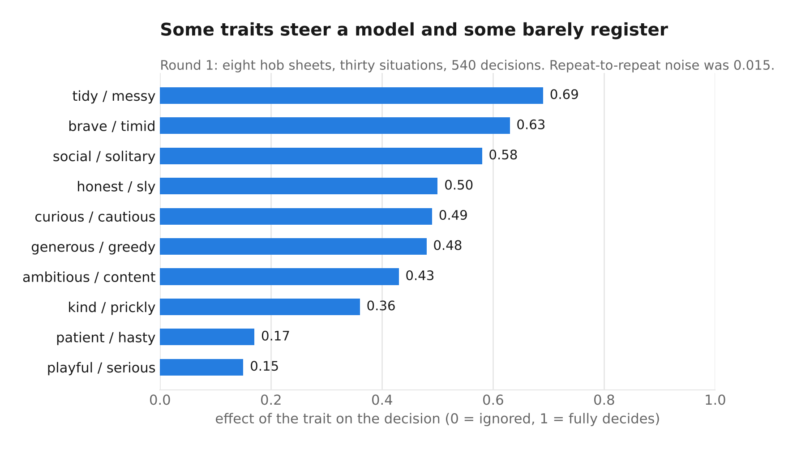
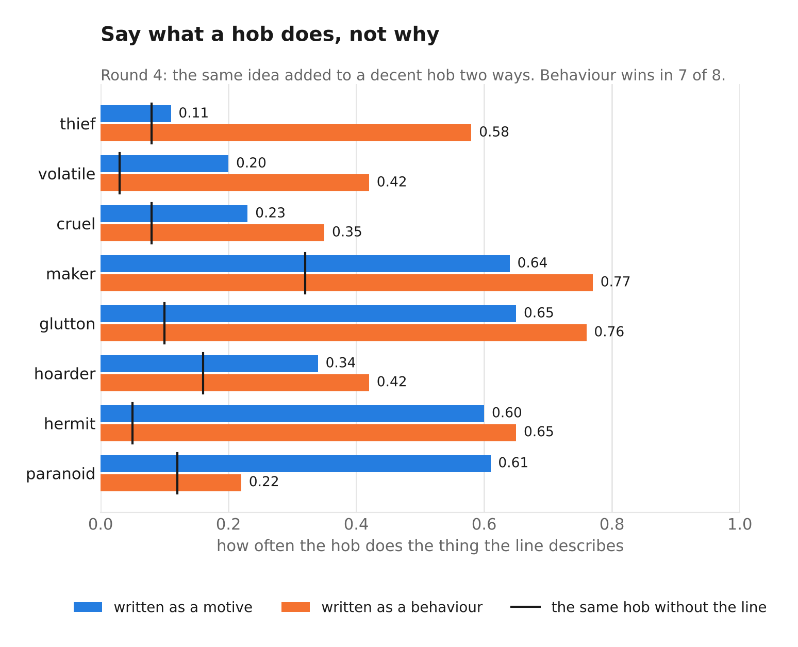
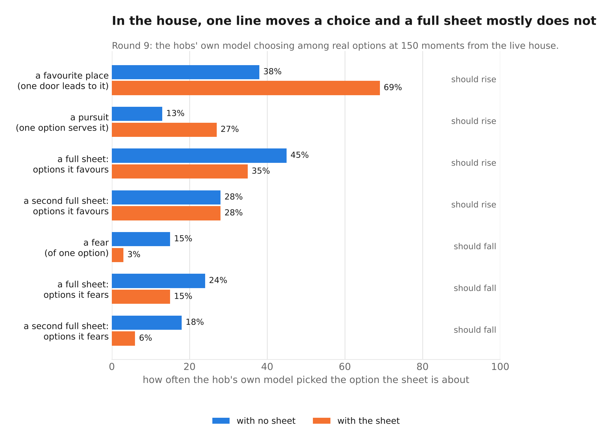
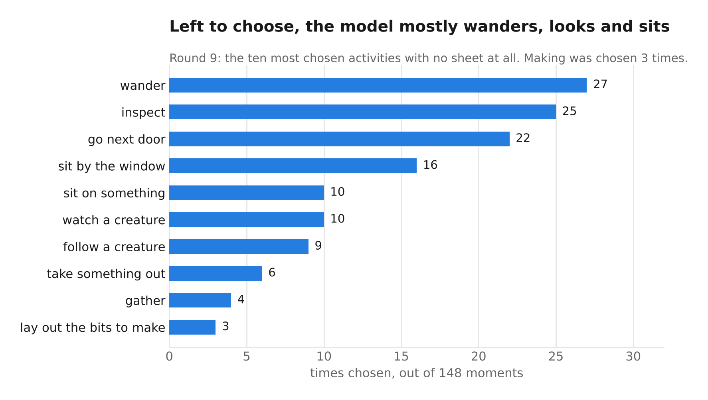

# The personality tests

By late November the hobs had traits, drives, flaws and moods, and still acted alike. Before changing the house
again, the personality system was tested on its own: write a hob's character as a short sheet, put the hob in a
situation, and ask a model what it does. Nine rounds, about 121,000 decisions, a little under three dollars.

Rounds 1 to 8 used Jev (`typesafe/jev-1.14`), a model built to make a decision and give a probability for it.
Round 9 asked the hobs' own model, with the house's real options. The reports, scripts and situations are in
[experiments/jev](../experiments/jev/).

## The short version

- A model reads a character sheet well. Most traits steer its decisions, and a few barely do.
- How a line is written matters more than what it says. Behaviour beats motive, and a habit beats a label.
- Hundreds of random hobs came out distinct from each other. No two were near-clones.
- None of that reached the house. Given the house's real options, the hobs' own model followed a single line and
  mostly ignored a full sheet, and with no sheet at all it chose to wander, look and sit.

The last point is the one the project turned on. A personality system can pass every test put to it and change
nothing, if the choice it has to act on is a list of passive things to do.

## What a model does with a sheet

Round 1 gave eight hobs a sheet of ten traits and put them through thirty situations. The sheet steered the
decision (an effect of 0.45 where 0 means ignored and 1 means the sheet decides), and 86% of picks went the way
the hob's trait predicted. A hob whose sheet pointed at the unwise answer chose it 92% of the time. Two traits,
patient and playful, barely moved anything.

Round 2 found the catch. A single trait leaks: "brave" moved its own situations by 0.37 and everything else by
0.31, so a brave hob also came out more ambitious, more curious and less honest. One framing sentence at the top
of the prompt moved the answers by 0.13 on average with no sheet at all. Traits did combine cleanly, though: an
ambitious and brave hob took the forge every time, a content and timid one never.

## How to write a line

Rounds 3 and 4 took ideas that traits could not express (a thief, a hermit, a hoarder, a hob coming apart) and
wrote each one several ways.

- **Behaviour beats motive.** "Greedy and dishonest: wants what others have and takes it" got a decent hob to
  steal 11% of the time. "Pockets small things that are not its own whenever nobody is looking" got 58%. Seven of eight ideas went the same way. Paranoia was the exception: it
  works better as a belief than as a habit.
- **A habit beats a label.** Calling a hob a thief got 24%. Describing the compulsion got 55%.
- **A good line stays in its lane.** The best lines changed the one behaviour and left the hob otherwise decent:
  it still shared, forgave and reassured about as often as before.
- **Lines can be generated.** Of forty behaviour lines put together at random from a when and a what, thirty-six
  were distinct, contained and big enough to notice.

## What else moved it

- **Relationships aim.** "Has not spoken to Pim since Pim broke its fishing rod" changed how the hob treated Pim
  and left its treatment of everyone else nearly alone (round 5).
- **A record builds.** Adding one line of history at a time to a kind hob, from catching frogs to hurting a
  smaller hob, raised how often it chose violence from 0.08 to 0.63, step by step (round 5).
- **Smartness did little.** From "very dim" to "brilliant" moved the smart answer from 0.48 to 0.67, and a hob
  with nothing stated scored 0.62. It was dropped (round 6).
- **Kinds of line differ.** Across 360 random hobs, every trait and every value changed behaviour beyond chance.
  Half the fears did. Only four of twenty quirks did, and age did nothing (round 7).
- **Wording moves the number, not the ranking.** The same question asked three ways shifted the answer by 0.07
  on average, but the same hobs came out high and low each time (round 6).

## Is every hob different?

Round 8 drew 340 random hobs with sheets of four to forty lines and compared every pair across 94 situations. Of
57,630 pairs, none were closer than 0.10 and eighteen were closer than 0.15. The cast differed in about fifteen
independent ways. The house's original ten-trait sheet, on an earlier and smaller set of situations, managed
about six. Long sheets still worked: a strong
trait held its effect whether the hob had four traits or fourteen.

## The house

Round 9 stopped asking a judge. It took 150 moments from the live house, each with the hob's real state and the
list of things it could actually do next, and asked the hobs' own model to choose, with and without a sheet.

- **One line works.** A favourite place took the door toward it from 38% to 69%. A fear took the feared option
  from 15% to 3%.
- **A full sheet mostly does not.** The options a whole sheet favoured were chosen no more often than with no
  sheet (35% against 45%, and 28% against 28%). The fears in it still held.
- **Two different hobs chose differently at the same moment 45% of the time.** That sounds like character until
  it is set beside the next number: asked the identical question twice, the model gave the same answer 62% of
  the time. Much of the difference was noise.

With no sheet, the model picked wandering, inspecting, going next door and sitting by the window. It chose to
start making something 3 times in 148. Its reasons read like the hobs they were: "already sitting, too sad to
move", "restless, need move, stores low".

## What it means

The sheet was never the problem. Jev could tell hundreds of hobs apart from a few lines of text, and so could
the hobs' own model when the question was clear. The problem was the question the house asked. A sad, proudless
hob offered eight small things to do will wander whatever its sheet says, because none of the eight is worth
wanting.

That is why Hob World does not start with a personality system. It starts with a hob that has something to lose
and options that matter, and brings character back as pressure the hob has to act on.

## Running it again

Each round folder has its script, its situations and its report. Rounds 1 to 8 need an OpenRouter key in
`OPENROUTER_API_KEY`. Round 9 needs the hobs' model served locally. The raw per-call results are not included,
only the reports and the summary tables. `charts.py` redraws the charts on this page.
