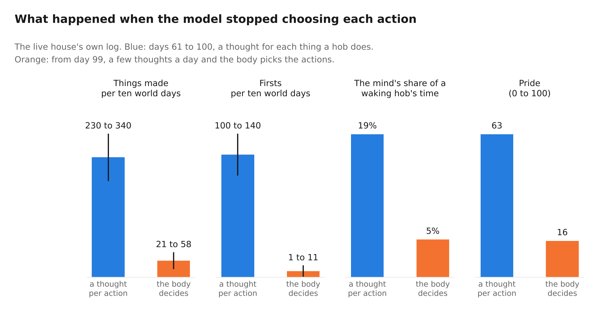

# Lessons

PetProject ran from early October to late November 2026. It began as one model pet in a box and ended as a twelve-room
house of hobs with families, trade, invention and a train. It is finished. The idea carries on as Hob World, a
fresh build. This page is what the first attempt taught.

## What it set out to be

A house of small free agents. Each hob would think for itself on a local model, have needs it had to keep up
with, a character of its own, and a life that went somewhere. Nothing scripted.

## What worked

- **The page.** Five tabs, a page for every hob and every thing, a family tree, a story by day, replay at up to
  60x. People could open it and understand a house in a minute.
- **The world.** 77 parts and 92 materials that decide what a made thing can do. Machines, cooking, a pond, a
  garden, seasons, weather, sickness, a work board, a train that carries things to the store.
- **Lineage.** Hobs hatch, grow old, die and leave a message. Words and beliefs pass down. The same parent's
  message made three different families in three runs.
- **Measuring.** Turbo time, replay, forty self-checks and a lab page made it possible to say what a family
  actually did over thirty world days instead of guessing.
- **Plain words in the prompt.** Feelings instead of numbers took "lab talk" from 43% of a pet's thoughts to
  under 5%. Telling a pet what it felt and from where let it act on a rule at its very next thought.

## What did not work

The hobs. They walked about, did small things, talked a little, and never looked like they wanted anything.
Release after release was aimed at that and none of them moved it. A house could run for a hundred and fifty
world days and still feel like nobody was home.

## Why

**1. The model stopped being the one deciding.**
Up to v3.6 the model had a thought for each thing a hob did. Hobs still spent much of their time resting, looking
and watching, so a body layer was added to keep them busy between thoughts. It fixed the idling and cost fewer
model calls, so it was given more to do with every release. In v4.0 it took over. The model was asked for four
things: a morning plan of two or three aims, a reaction to something notable, a conversation, and a reflection
at bedtime. Every action a hob took was chosen by the body, which scored a list of activities and did the best
one.

The house's own log, read in ten-day stretches, shows what that did:

Thoughts fell from about 1,500 every ten days to between 330 and 500. With nothing new being made, pride fell
from 63 to 16 and curiosity from 55 to 37, the hobs turned on each other, and snubs reached 262 in ten days
where there had been no conflict at all. The house did not get quieter because the hobs were content. It got
quieter because the thing that made them do new things had been switched off.

**2. Each time the model disappointed, it was scripted around.**
The findings said early that the model, left alone, settles: with nothing pushing it, it rested at full energy.
They also said what it needed: pressure, and a way to feel it. The response each time was to move the behaviour
into the body. Telling a pet that the storeroom was a mess moved nobody, so the body was made to tidy. That got
the storeroom tidied and took one more decision away from the hob.

**3. There was no real pressure.**
Hunger fell by about seven points in a hundred per world day. The body ate without being asked. Starving took
five world days. A hob that did nothing at all was fine, so there was nothing to stay ahead of and no reason to
get better at anything.

**4. Character had nowhere to act.**
Traits, drives, flaws and moods were all real data, and all of it reached behaviour the same way: as a small
adjustment to the body's scores. Give two hobs opposite characters and they did nearly the same things in nearly
the same order.

The personality tests ([JEV.md](JEV.md)) made this exact. A model can tell hundreds of hobs apart from a few
lines of text, and how the lines are written matters a great deal. But asked to choose among the house's real
options, the hobs' own model followed a single clear line and mostly ignored a full sheet. With no sheet at all
it chose to wander, inspect, go next door or sit by the window, and chose to start making something 3 times in
148. The options on offer were small, and a sad hob with nothing at stake picked the smallest.

**5. The brain was sized last.**
One model call at a time for the whole house, a budget of 150 calls an hour, and at least 70 seconds between one
hob's thoughts. Two calls at once measured no faster on one machine. The house grew to seven hobs and twelve
rooms first, and the thinking was rationed to fit what was left.

**6. Features were added on top of all that.**
Fishing, machines, a grammar of parts, jobs, projects, habits, a train. Each one was built well and each one
gave the hobs more they could do. None of them changed who was choosing, so none of them made a hob more alive.
The work was real and it was aimed at the wrong layer.

**7. "Does it look different?" is not a measure.**
Most changes to behaviour were judged by watching the page for a while. That cannot tell a small real change
from none. The one thing the project never had was a number for how alive the hobs were.

## The last change

The final commit gave the choosing back to the model: a thought for each action again, the fighting switched
off, and old grudges cleared once. That is the state of this repo. It was the right correction and it came
late. It restores the house of day 61 to 100, which made things and had firsts, and which was also the house
where the mind decided only 19% of a hob's waking time and the rest was the body filling in. Getting from there
to hobs that are alive needs the other reasons on this page fixed too, and those are in the foundation.

## What changes in Hob World

- **Brain and body first, and nothing else.** One hob in a bare room. No second feature until that hob keeps
  itself alive without help.
- **The body never decides.** It walks, carries out an action and repeats a routine the hob already worked out.
  Every choice is the model's.
- **Actions and results.** The hob picks one real action from what is possible. The world says what happened,
  or why it failed, and that goes into the next thought.
- **Doing nothing costs something.** Food takes work. Hunger is fast enough to matter. A hob that stands still
  dies, slowly and visibly, and the model is told in plain words how its body feels.
- **Character is pressure.** A trait is a need of its own that builds until the hob acts on it, not a modifier
  on a score.
- **Skills save thinking.** A problem a hob has solved becomes a routine the body can run without the model, so
  thought goes to new problems.
- **Size the brain first.** Work out how many thoughts each hob can have per minute on the hardware, then
  decide how many hobs there are.
- **The world comes back when a hob needs it.** The page, the art, the parts and the data from this project are
  the starting stock. Each piece returns when it gives a living hob something to do.

## If you are building something like this

- Get one agent alive in the smallest possible world before building the world.
- When the model is passive, change what it stands to lose before you change who decides.
- Keep a number for the thing you care about most. If you cannot name it, you cannot tell whether a change
  worked.
- A layer that makes the demo look better while taking decisions away from the model is a debt. It will be the
  hardest thing to remove later.
