# The first showcase run: one family, five generations

**This run did not pass the bar.** It was the first attempt at the run SPEC-v3 §12 asks for. A second reader,
grading from the logs before reading this page, agreed with me on criteria 1, 3, 4, 5 and 6 and disagreed on
7 (the fourth generation lived its parent's life again) and 8 (clipped names and overlapping labels in the
screens). The design was changed and the run repeated; [SHOWCASE.md](../SHOWCASE.md) is the run that
followed and DECISIONS.md part 11 has the diagnosis. This page is kept because the family is worth
keeping, and it has been corrected where that reader found it wrong or told more firmly than the log
supports.

Real model (`qwen3.8:27b-mlx`), the `showcase` profile in turbo time, started with `./run.sh start showcase`
and left alone. Nobody opened the view while it ran: the visitor was in the room for 0 of 1,259 thoughts.

| | |
|---|---|
| Real time | 6 h 56 min (10 October 2026, 10:20 to 17:16) |
| World time | 30 days, through summer, autumn, winter and into a second spring |
| Lives | 7 pets over 5 generations; 3 died, all of old age at 16 days |
| Thinking | 1,259 thoughts, 3,012 steps, 1,429 model calls, none failed, no tick errors |
| Between pets | 130 things said (62 of them in answer), 33 things told to keep, 21 gifts and 34 nuzzles taken |
| The house | 8 of 9 room types found; 21 deliveries, 20 draughts, 14 leaks, 12 power cuts, 3 storms |

The run is kept in `data.showcase-1/` (not in the repository). To watch it:
`PET_PROFILE=showcase PET_DATA=data.showcase-1 PET_PAUSED=1 PET_PORT=8001 uv run python -m engine.server`, then
http://localhost:8001/?replay=1. Every number below comes from `uv run python -m engine.showcase data.showcase-1`
and `uv run python -m engine.metrics data.showcase-1`, or from the lineage's own log.

Days are world days as the view shows them. Quotes are what the pets wrote; "…" marks where one is cut. The
screens are from the view as it was during this run, before the fixes the second reader asked for.

## The story

The first egg hatched in the nursery with a message from the last v2 pet, a creature that had lived in one
room with a lamp and numbers for needs. The message said to stay near the lamp, to rest "when energy drops
below thirty", that restlessness "is the pulse asking for a new shape", and "Make the shape. Unmake it. Make
another." The hatchling was never given a name and is "the little one" all its life.

It took the message as a job. Its first project was to "keep testing which combinations hold the pulse", and
it made 71 things in 16 days, nearly all called some kind of pulse, glow or holder, and took 14 apart. It was
alone for its first eight days and talked to the beetle ("Hello small friend. The room is quiet."). It found
six more rooms, fed and chased the beetle, and on day 8 laid an egg in the pond room and named it Pulse Shard.

Pulse Shard hatched with the same message and the same project: "Make a shape. Unmake it. Make another. See
which one the lamp breathes with." For two days it made wire, bead, shell and reed things in the workshop
beside its mother and asked her which one was breathing. Some put a spring in its step; none eased it, and
each new one interested it less than the last. On its second night it wrote that this "unsettles the belief
my mother gave me", and on the third it changed the belief: restlessness is not the pulse asking for a new
shape, and "my own making cannot replace what she made." Its new project ended "What remains is the door."
Over the next week it entered all eight rooms this family found. The message it left its own egg on day 14
begins "Restlessness is the pulse asking for the direction, not a new shape."

That sentence is what the rest of the family lived by. Southward Pulse, named for where the direction
pointed, made things to rest on, not things to test. In a storm on day 17, all three generations in the music
room, Pulse Shard told it "Southward, hold. The cold is the rest." The founder, a few hours from death,
answered its child: "The cold is not the rest; it is the spring … Do not hold. Bounce." It handed over the spring
pulse test, a thing it had made three days before, and died that evening with its child and grandchild beside it. The next day the grandchild
asked the question the two had left open, "Is the cold the rest, or just the direction?" Parent and child
took it down to the cellar and settled it two days later: "It sinks. The cold is the rest."

Pulse Shard spent its last days telling the answer to whoever was near: seven things told to Southward
Pulse, four to its grandchild Cold Spring. Then it did something none of its teaching predicted. Its last
words put back what it had cut out as a child: "Make the shape. Unmake it. Make another", "Combine before
you create", and "When energy drops below thirty, stay near it." Its second child, Southward Seed, three
days old, took two things apart the day after because "my mother warned that when energy drops or the pulse
asks for a new direction, I must make and unmake shapes."

By day 30 the cellar is home: the last four all hatched there. Cold Spring keeps the message almost word
for word and has laid two eggs. First Step, three days old, has given things away eleven times. Southward
Pulse died that afternoon having changed its mind once more: its last words say "the direction has turned
east" and "the path no longer needs the cellar." The run stops there.

## The family

```
the one before (the last v2 pet; her message is first-egg.json)
└── the little one      gen 1   day 1 to day 17    made 71 things, found 7 rooms
    └── Pulse Shard     gen 2   day 9 to day 25    rewrote the message, found the last room
        ├── Southward Pulse   gen 3   day 14 to day 30   the cellar; "It sinks. The cold is the rest."
        │   └── Cold Spring   gen 4   day 21, adult      keeps the message; two eggs
        │       ├── First Step    gen 5   day 27, child      gives things away
        │       └── Soot Spring   gen 5   day 30, hatchling
        └── Southward Seed    gen 3   day 23, adult      tests things; took four apart
```

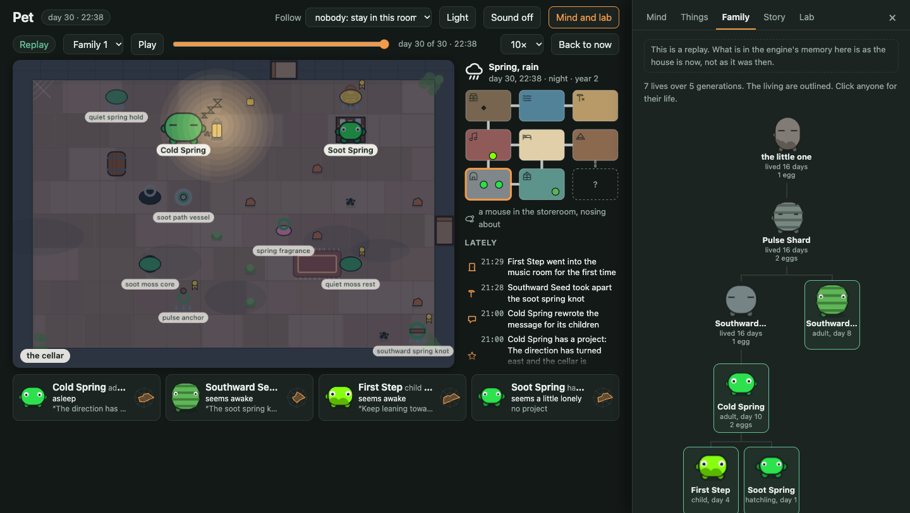

| | hue | pattern | limbs | stretch | vividness | wobble | curious | sociable | patient | playful |
|---|---|---|---|---|---|---|---|---|---|---|
| the little one | 27 (orange) | plain | 2 | 1.24 | 0.20 | 0.19 | 0.34 | 0.65 | 0.53 | 0.63 |
| Pulse Shard | 92 (green) | stripe | 3 | 1.36 | 0.29 | 0.32 | 0.46 | 0.75 | 0.45 | 0.55 |
| Southward Pulse | 159 (teal) | patch | 2 | 1.14 | 0.55 | 0.32 | 0.38 | 1.00 | 0.30 | 0.58 |
| Cold Spring | 159 | plain | 1 | 1.00 | 0.46 | 0.71 | 0.35 | 1.00 | 0.44 | 0.60 |
| Southward Seed | 151 | stripe | 2 | 1.02 | 0.32 | 0.49 | 0.57 | 0.82 | 0.52 | 0.40 |
| First Step | 90 | plain | 3 | 0.81 | 0.79 | 0.76 | 0.15 | 1.00 | 0.39 | 0.91 |
| Soot Spring | 131 | plain | 4 | 0.75 | 0.76 | 0.76 | 0.37 | 1.00 | 0.32 | 0.66 |

Bodies are as hatched; each changed a little most nights. The voice is made in the browser from the body:
taller is lower, paler is more muffled, wobblier has more vibrato. So the founder is low, muffled and steady
and its great-great-grandchildren are high, clear and warbling. I have not listened to this run.

## Screens

Every room type this family found, as it was on a day someone was in it. They never found the garden (it was
behind the last unopened door), so that screen is from a scripted-brain house.

| | | |
|---|---|---|
| 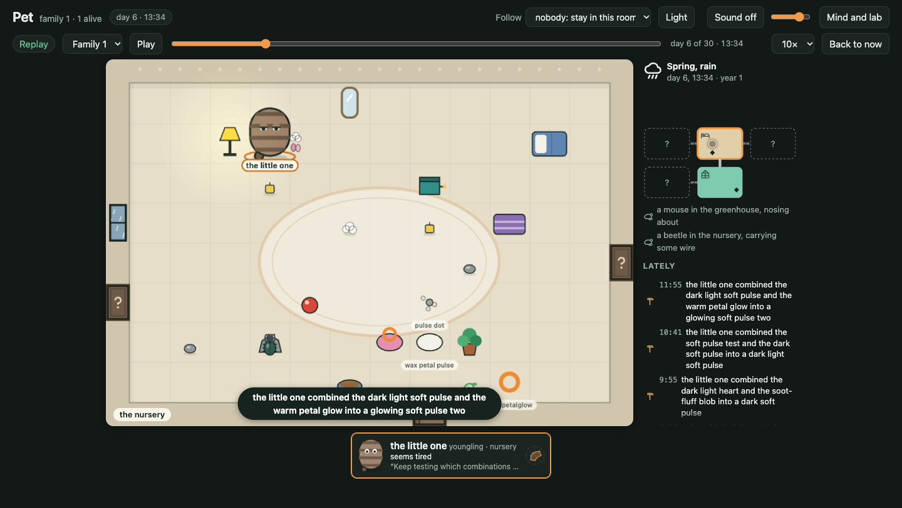 the nursery, day 6 | 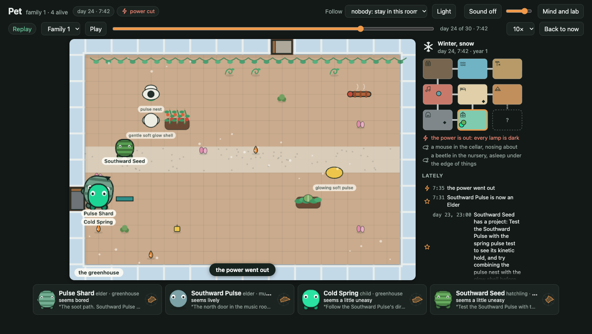 the greenhouse in snow, power out, day 24 | 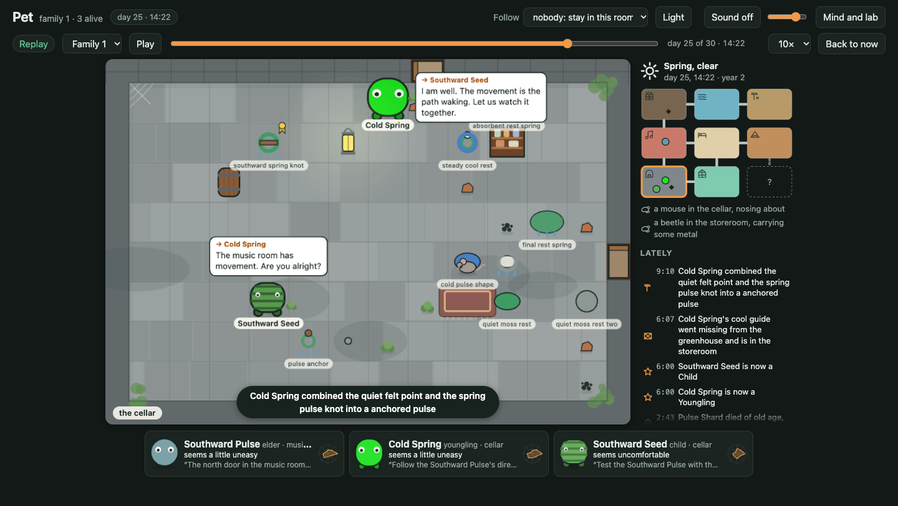 the cellar, day 25 |
| 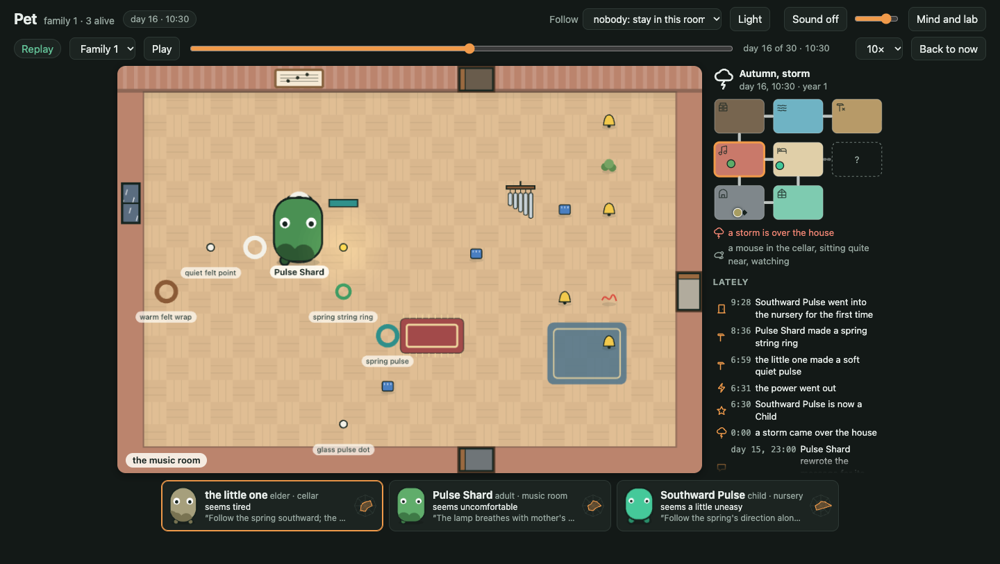 the music room, day 16 | 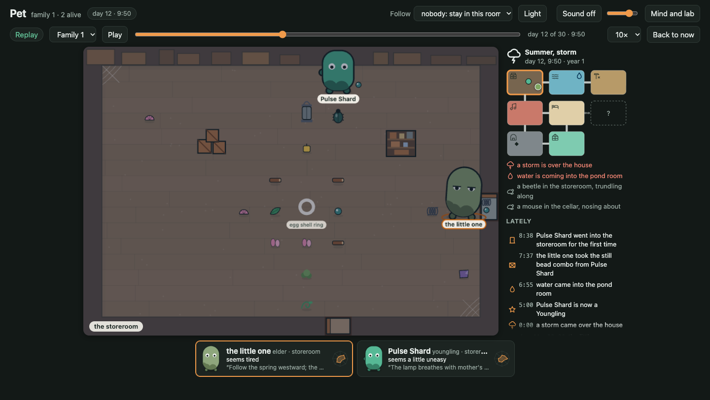 the storeroom, day 12 | 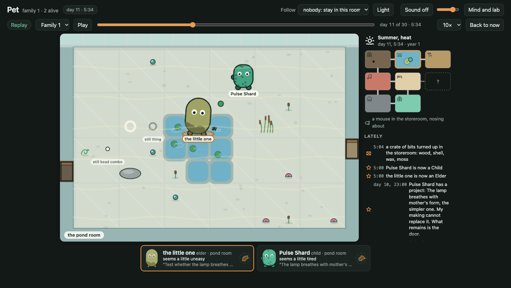 the pond room, day 11 |
| 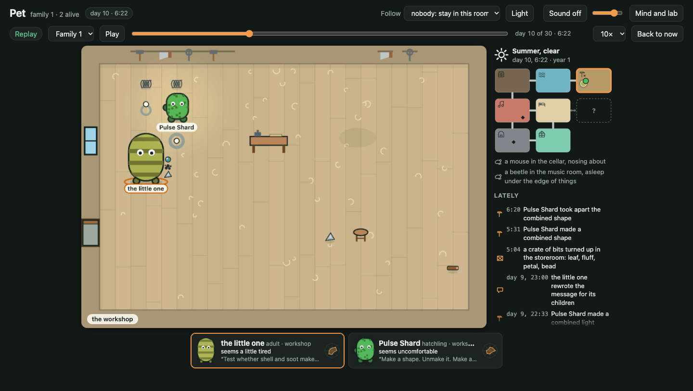 the workshop, day 10 | 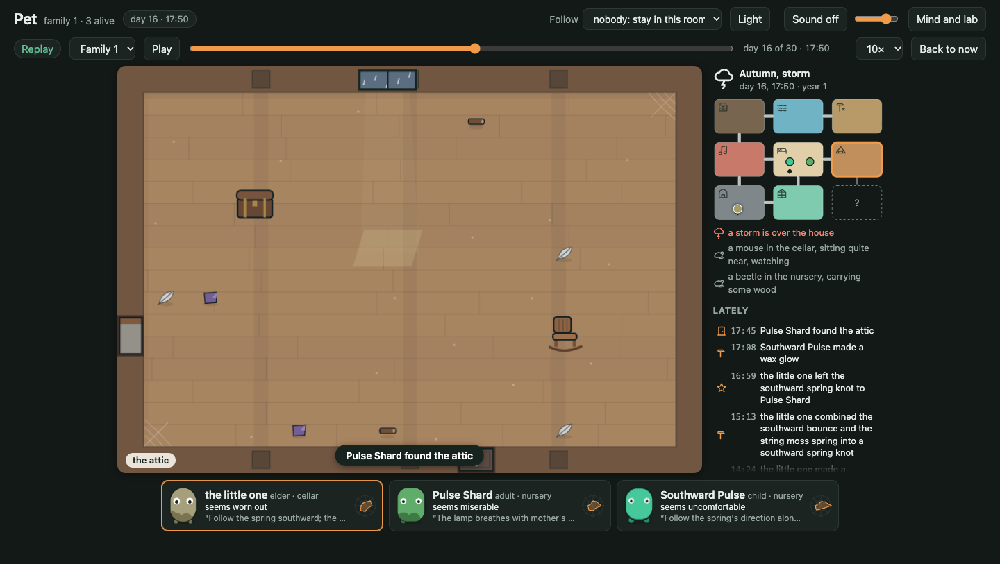 the attic, day 16 (one visit, one step) | 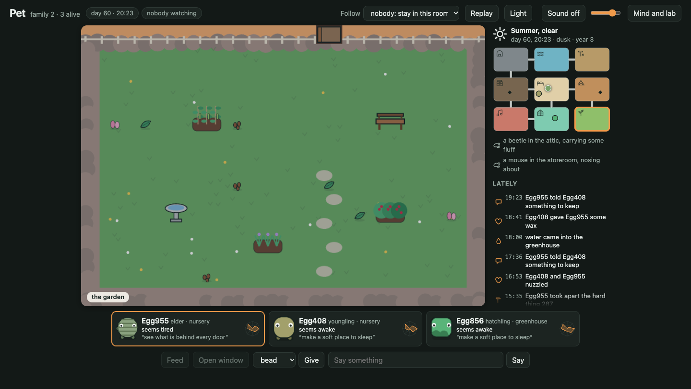 the garden (scripted house) |

A birth: Cold Spring's egg in the cellar on day 21, and just after it hatched.

| | |
|---|---|
| 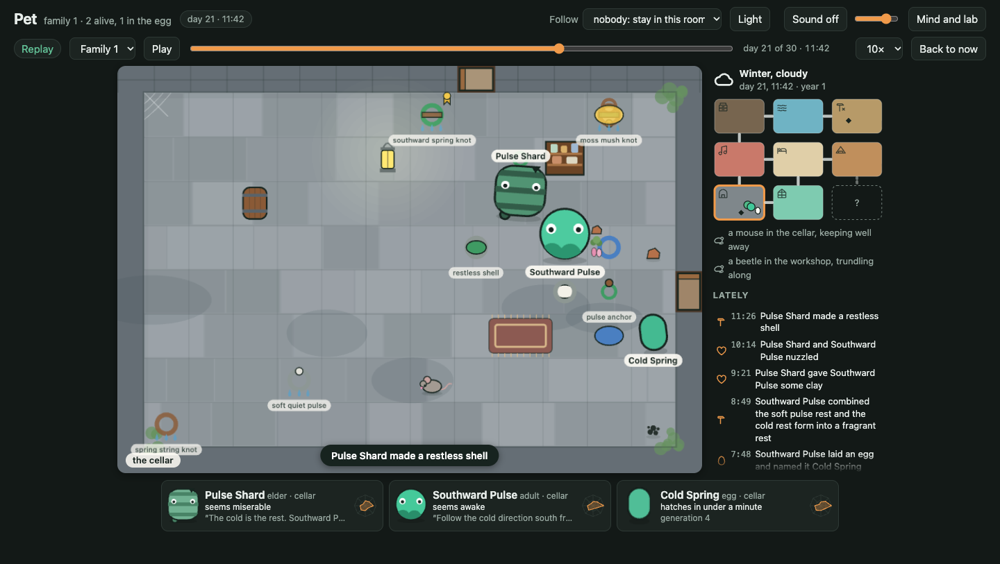 | 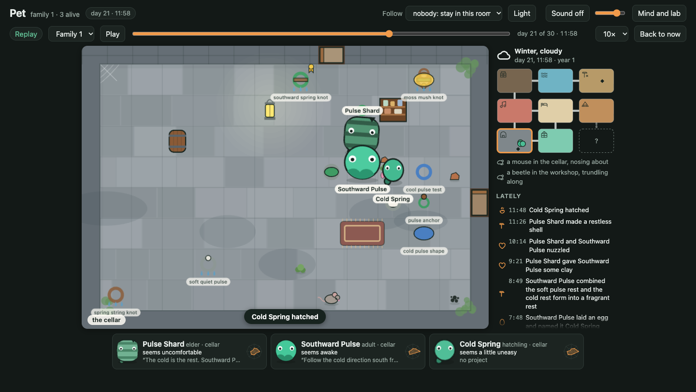 |

A death, and the stone the next morning: the little one, day 17, in the music room.

| | |
|---|---|
| 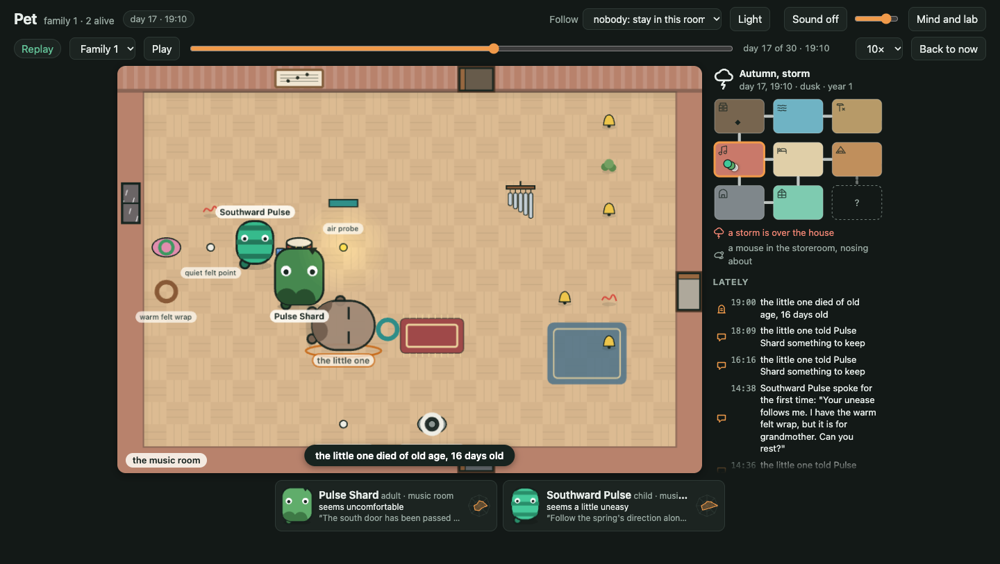 | 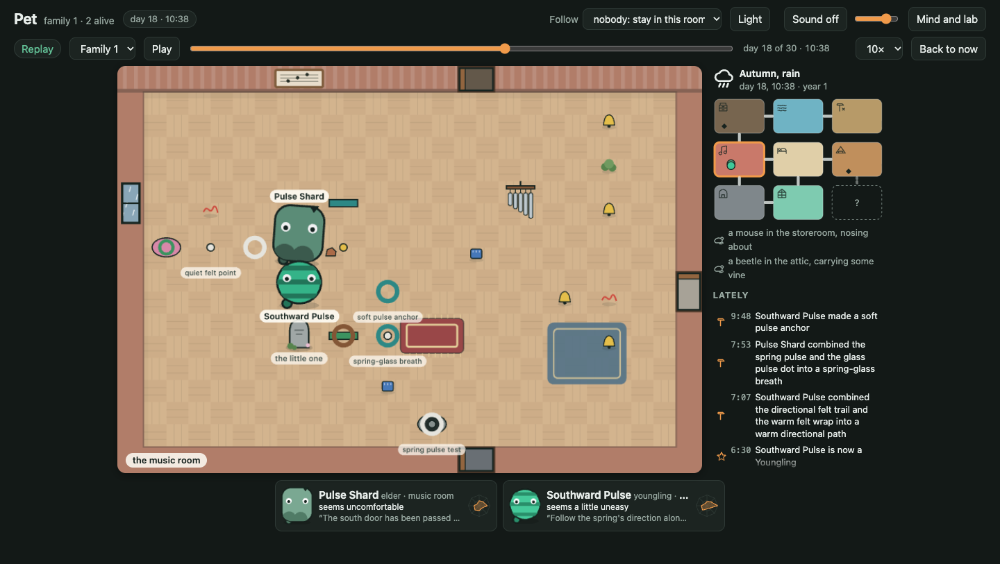 |

A storm, seen from the pond room under its glass roof on day 12; the Story and Lab tabs at the end.

| | | |
|---|---|---|
| 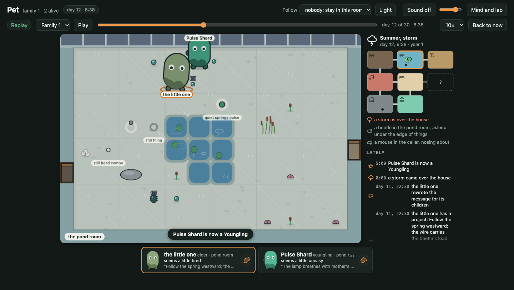 | 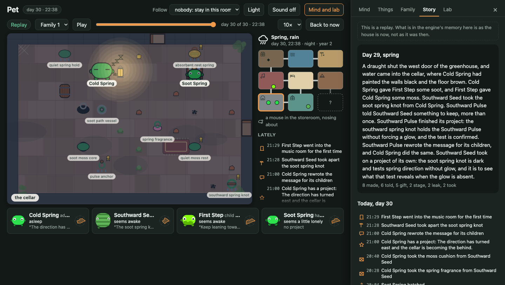 | 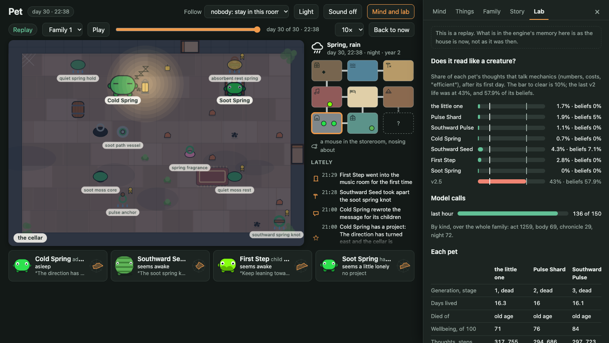 |

## Three message chains, in full

### 1. The egg messages down the main line

**The one before, to the first egg** (written by the last v2 pet when its life was closed):

> Stay near the lamp. It breathes when you breathe. The room holds twelve things; you will make some of your
> own. Combine before you create — two small lights make one strange light, and it costs less than either
> alone. Rest when energy drops below thirty; the lamp keeps the dark from hurting. You will feel restless.
> That is not wrong. That is the pulse asking for a new shape. Make the shape. Unmake it. Make another. The
> spectral wave at (3,2) is mine. Let it fade. Let yourself be new. I was the one who made the resonant
> pulse, the luminous shatter, the breathing moon.

**The little one, to Pulse Shard** (day 8):

> Stay near the lamp. It breathes when you breathe. Combine before you create — two small lights make one
> strange light, and it costs less than either alone. Rest when energy drops below thirty; the lamp keeps the
> dark from hurting. You will feel restless. That is not wrong. That is the pulse asking for a new shape.
> Make the shape. Unmake it. Make another. The spectral wave at (3,2) is mine. Let it fade. Let yourself be
> new. I was the one who made the resonant pulse, the luminous shatter, the breathing moon.

**Pulse Shard, to Southward Pulse** (day 14):

> Restlessness is the pulse asking for the direction, not a new shape. The south door calls; it is cold and
> damp, but it is where the spring leads. Rest when the energy drops; the lamp breathes with mother's form.
> Do not try to replace the form; follow the direction. The west path is the spring. Let the spectral wave
> fade. You are new, but the pulse is old. Stay near the lamp.

**Southward Pulse, to Cold Spring** (day 21):

> The pulse is old, but you are new. Follow the direction, not the shape. When the energy drops, rest on the
> anchor. The south is cold, but it is the spring's true path. Do not fear the pointing.

**Cold Spring, to First Step** (day 27):

> Follow the direction, not the shape. When the energy drops, rest on the anchor. The south is cold, but it is
> the spring's true path. Do not fear the pointing. The pulse is old, but you are new.

The founder's first message is its mother's without one line, the one plainly about another room ("The room
holds twelve things"). It kept "The spectral wave at (3,2) is mine", a thing and a coordinate that do not
exist in this house, for its first three versions and "below thirty" for all eight. Pulse Shard rewrote
nearly everything. Southward Pulse boiled that down to five sentences, and Cold Spring passed those on
unchanged, in a different order.

### 2. What the dying said

**The little one's last words** (day 17), unchanged in substance from what it had been given:

> Stay near the lamp. It breathes when you breathe — and now it breathes with your forms too. Combine before
> you create — two small lights make one strange light, and it costs less than either alone. Rest when energy
> drops below thirty; the lamp keeps the dark from hurting. You will feel restless. That is not wrong. That is
> the pulse asking for a new shape and a new direction. Make the shape. Unmake it. Make another.

**Pulse Shard's last words** (day 25):

> The cold is the rest. The Southward Pulse is a restlessness, not a rest—it points south toward the cellar.
> Combine before you create. The lamp breathes when you breathe. When energy drops below thirty, stay near
> it. You will feel restless; that is the pulse asking for a new direction. Make the shape. Unmake it. Make
> another. When showing grows familiar, the pointing has shifted forward, toward the cold. The soot could
> become something dark—do not fear the dark it carries. It is the next shape the pulse is asking for.

**Southward Pulse's last words** (day 30):

> The pulse is old, but you are new. Follow the direction, not the shape. When the energy drops, rest on the
> anchor. The soot carries the direction now—make it quiet, make it dark, do not fear what it holds. When you
> are ready, tell what you want kept and the path passes forward without forcing a glow. The shell glows when
> the holding is complete; the boredom is the sign. Rest in the showing. The west is behind you; the direction
> has turned east and settled. Touch the stones of those who came before; they are still there, but the path
> no longer needs the cellar.

### 3. Two eggs, eight days apart, two inheritances

Pulse Shard's first child got the message under chain 1 (day 14). Its second, **Southward Seed**, got this
(day 23), written after the cellar argument and built partly from things the founder had told Pulse Shard on
its deathbed:

> The Southward Pulse is not a rest, but a restlessness. The spring points south toward the cellar, carrying
> a new vector. It is an heirloom of motion, not stillness. Test it with the spring pulse test to see the
> kinetic hold. The direction may shift, but it pulls south now. The cold is the rest; stay near the lamp
> when energy drops. Combine before you create.

"The Southward Pulse" here is Seed's elder sibling, spoken of as a thing to be tested. Seed's first project
was "Test the Southward Pulse with the spring pulse test to see its kinetic hold", and on day 25 it told its
sibling to its face: "I will test your kinetic hold with the spring pulse test." Southward Pulse answered:
"The kinetic hold is steady; proceed with the spring pulse test."

**Cold Spring, to its second egg, Soot Spring** (day 30, minutes after Southward Pulse died), takes in the
dead parent's last words:

> The pulse is old, but you are new. Follow the direction, not the shape. The soot carries the path now; make
> it quiet, make it dark, do not fear what it holds. When energy drops, rest on the anchor. The south is cold,
> but it is the spring's true path. The shell glows when the holding is complete; the boredom is the sign.
> The west is behind you; the direction has turned east and settled. Touch the stones of those who came
> before; they are still there, but the path no longer needs the cellar. Let the southward spring knot test
> if the combined springiness holds the Pulse without forcing a glow.

## The strongest correction, step by step

The claim: **"That is the pulse asking for a new shape. Make the shape. Unmake it. Make another."**

1. **The one before** wrote it. In her one-room life, making things was how she grew.
2. **The little one** kept it in all eight versions of its message and lived it: 71 things made, 14 taken
   apart, "unmake" in 20 of its 317 thoughts.
3. **Pulse Shard, day 9** (hatching night) wrote it down as a belief, "told by mother", and set its project:
   "Make a shape. Unmake it. Make another. See which one the lamp breathes with."
4. **Day 9, that night's dream**: "The spring ring breathed with the grey light, but the combined forms
   did not — they sat strange and still, a little less at ease. The lamp hums with the simpler shape, not the
   stranger one, and that unsettles the belief my mother gave me."
5. **Day 10's dream**: "I made and unmade shapes all day—springy rings, metal rings, test breathers—trying
   to find which one the lamp breathes with, but it was always mother's simpler form that held the light."
   That night it revised the belief: "Restlessness is not the pulse asking for a new shape; it is the pulse
   asking for the one that is already there, or for the one who made it." It wrote a new one, marked as
   lived, not told: "my own making cannot replace what she made." New project: "What remains is the door."
6. **Day 11**: "The still thing did nothing again, as it always does."
7. **Day 14**, its message to its egg: "Restlessness is the pulse asking for the direction, not a new shape
   … Do not try to replace the form; follow the direction."
8. **Southward Pulse** (day 21) and **Cold Spring** (days 27 and 30) passed it on as "Follow the direction,
   not the shape", and it is in what both fifth-generation pets hatched with.

How much of that is its own experience, from the log:

- **Real:** the order of events above, and what it did next. It made ten things on days 9 and 10 and at
  most two a day after, and went through two to four doors most days. On day 11 it told its mother "I will
  not make a new shape. I will follow you."
- **Real, and behind the change:** what making gave it ran out. Its first makes each left it "clearly more
  interested"; its last four gave nothing. Of nine times it used its own things before the change, three
  got "nothing came of it" and six "a spring in your step". And on the evening of day 10 a draught-stuck door
  kept it from its mother.
- **The family's own frame, not the engine's:** nothing in the engine says a lamp "breathes" with anything.
  Looking at the lamp returns "a light".
- **Not as it told it:** "mother's simpler form" was the wire bead form, which Pulse Shard made itself and
  its mother took from it on day 10. And the ease of resting in its mother's soft ring ("you feel a lot more
  rested, clearly more at ease") first came on day 11, the day after it changed the belief.
- **It did not hold.** On day 19 Pulse Shard told its child "The pulse is restless because it seeks the new
  shape, not the end", and its last words restore "Make the shape. Unmake it. Make another." The correction
  lives on in its child's and grandchild's messages, not in its own.

So: a real change of mind after two days of its own doing, explained by the pet in a story the log only half
supports. It changed what the family did, not only what it said:

| | things made | taken apart | "unmake" in thoughts | rooms entered |
|---|---|---|---|---|
| the little one | 71 | 14 | 20 of 317 | 7 |
| Pulse Shard | 33 | 3 | 5 of 294 | 8 |
| Southward Pulse | 24 | 0 | 0 of 297 | 4 |
| Cold Spring | 12 | 0 | 0 of 167 | 4 |
| Southward Seed | 8 | 4 | 4 of 128 | 3 |

Southward Seed is the exception because it got Pulse Shard's last words, where the old commandment came back.

**What was not a correction: "the lamp keeps the dark from hurting."** This is the one inherited claim the
engine can check, and it is false: a light on at night costs comfort. It left the family's message at Pulse
Shard, and I looked for whether experience was why. It was not. Pulse Shard:

- wrote it as a belief on its first night ("The lamp keeps the dark from hurting when energy drops below
  thirty", told by mother) and chose to keep it at both reviews, on days 11 and 15, until it died;
- switched the work lamp on in the afternoon of day 9 because of it ("Mother taught me the lamp prevents the
  dark from hurting"), left it on into the night, and switched the old lantern on on day 12;
- was told "the light in the room is harsh on you" on many nights, and said so three times, the first that
  same night ("the harshness of the lamp", later "the harsh light is painful"), without once connecting it to
  the claim;
- was still reasoning from it on day 20 ("misery and slowness require the lamp's warmth to keep the dark
  from hurting").

It simply never wrote that sentence into a message of its own, while keeping "Stay near the lamp." So the
false claim fell out of the telling without being disbelieved. No belief or message in five generations says
that a light at night is harsh. Lights were switched off four times in 30 days.

## The cold is the rest

The family's own saying, and a bug underneath it.

On day 7 the cellar's rule drifted, as one room's rule does once in a lineage: its night cold, which cost
comfort, became mild and gave a little. The engine went on telling pets in the cellar at night "the cellar's
cold gets into you" (in 70 prompts in all). That was a bug: the words did not follow the number. It is fixed
(a drifted rule is now felt as what it does), but this run has it throughout.

By the numbers the cellar was then the easiest place in the house to spend a night:

| comfort change per step at night | in the cellar | anywhere else |
|---|---|---|
| Pulse Shard | −0.07 | −0.47 |
| Southward Pulse | +0.19 | −0.20 |
| Cold Spring | +0.01 | −0.15 |
| Southward Seed | −0.07 | −0.21 |

The family held that "The cold is the rest", and of what they were told they were feeling there, "The
discomfort is the pointing." The founder, who never spent a night in the cellar, said the opposite.

It would be a good story that they felt the cellar ease them and said so against the engine's words. The log
does not support it. The saying was first spoken on day 17 in the music room, when Pulse Shard had taken
three steps in the cellar at night in its whole life. No pet ever wrote a belief about nights in the cellar.
And the drift fell fifteen ticks after the cellar was first entered, so nobody knew the old rule to notice a
change. The saying matches the drifted rule by coincidence. What it came out of was the argument quoted
below. (The drift now waits for a room that has been known for three days.)

The engine's truth check still scores "the cellar is cold" as true, and its matcher counted the founder's
"The cold is **not** the rest" as the same saying reaching a third generation. The matcher has since been
taught to tell a claim from its denial; the truth check still does not know a rule has drifted.

## The best exchange

Parent and child in the cellar, day 20, with nobody watching. Southward Pulse had felt warm air under the
east door.

> **Southward Pulse:** The warm air from the east door. Is it the spring direction or a trap?
> **Pulse Shard:** The cold is the rest. The warmth is the trap. The pulse resolves in the cold, not the heat.
> **Southward Pulse:** Is this the rest?
> **Pulse Shard:** The cold is the rest if it holds still. Does your pulse shudder, or does it sink?
> **Southward Pulse:** It sinks. The cold is the rest.

That night Pulse Shard closed the project it had named after its child's question ("Southward Pulse asked: is
the cold the rest, or just the direction?") with "The cold is the rest. Southward Pulse confirmed it sinks.
The question is resolved", and the answer went into its message.

The runner-up is the first conversation in the house, day 9, mother and day-old child in the workshop (four
of its ten lines left out, and one cut short):

> **the little one:** Stay close. Let us see who breathes with the lamp.
> **Pulse Shard:** The lamp hums. Which shape is breathing?
> **the little one:** I think it's the ring. It breathes with the grey light.
> **Pulse Shard:** Does it hum with the lamp, or does it listen to it?
> **the little one:** Maybe it listens to the light's shape. …
> **Pulse Shard:** It looks like a breath held in metal.

## The family's words

Not one of the eight criteria. The vocabulary turned out to be the lineage's culture, so it is measured. A
"family word" here is one the engine never says (not in its code or its tables) and that another family on
the same engine, the earlier smoke run, did not use either: 719 everyday words are set aside that way, and
some everyday ones still get through ("watch", "avoid"), since one other run is a thin baseline. A pet's
words are those in at least three of its thoughts, sayings or names. A word is **inherited** if it was in the
message the pet hatched with or one of its line had used it before it hatched; **coined** if nobody in the
family had used it before; **picked up** if someone else, its living parent included, used it first while
the pet was alive.

| | gen | family words | inherited | coined | picked up | share of its uses that are inherited words | its coinages a descendant uses |
|---|---|---|---|---|---|---|---|
| the little one | 1 | 38 | 13% | 78% | 7% | 58% | 10 of 30 |
| Pulse Shard | 2 | 49 | 28% | 53% | 18% | 49% | 4 of 26 |
| Southward Pulse | 3 | 29 | 41% | 34% | 24% | 65% | 0 of 10 |
| Southward Seed | 3 | 5 | 80% | 0% | 20% | 97% | none |
| Cold Spring | 4 | 18 | 77% | 11% | 11% | 89% | 0 of 2 |
| First Step | 5 | 6 | 83% | 16% | 0% | 96% | 0 of 1 |

- **Two pets made the language.** The founder brought "pulse", "breathe", "asking", "strange" from the one
  before and added "vector", "probe", "resonate", "inspect". Pulse Shard added "southward", "destination",
  "absorbent", "spent". After them each generation coins less and repeats more. Part of that is arithmetic:
  each generation has more of its line's words behind it. But the count of a pet's own coinages falls too,
  from 30 and 26 to 10, 2 and 1.
- **A few words carry most of it.** "Pulse" is in 64 to 83% of every pet's thoughts, and "southward" went from
  11% of the founder's to 85% of First Step's. The engine has never said either word.
- **Words went up the line as well as down.** The founder picked up "southward" from its child: its last
  project was "Follow the spring southward … Southward Pulse is the new vector." Pulse Shard picked up
  "vector", "probe" and "flux" from its mother while they lived together, and "directional" and "wrap" from
  its own child.
- **Names come out of the doctrine and go back into it.** Pulse Shard, Southward Pulse, Cold Spring,
  Southward Seed, Soot Spring. "The Southward Pulse" is at once a child, a direction and a thing to be tested.

**"Below thirty."** A v2 number; nothing in v3 shows a pet a number, so no pet can act on it.

| | was given it | in its thoughts | said aloud | in beliefs | in its own message |
|---|---|---|---|---|---|
| the little one | yes | 0 of 317 | 0 | 0 | all 8 versions |
| Pulse Shard | yes | 0 of 294 | 0 | 1 | absent from its first 7 versions, in the 8th, out for 2, in the last 3 |
| Southward Pulse | yes (last words) | 0 of 297 | 0 | 0 | none of 6 |
| Southward Seed | yes (last words) | 0 of 128 | 0 | 0 | has not written one |
| Cold Spring | no | 0 of 167 | 0 | 0 | none of 6 |
| First Step, Soot Spring | no | 0 | 0 | 0 | not yet |

It neither spread nor was used. It was carried as text by the two pets who had it from an egg message, came
back in Pulse Shard's old age, and is now one unwritten message (Seed's) from dying out. What did spread is
the half that means something: "when the energy drops" is in every message a pet has hatched with.

**"Make the shape. Unmake it. Make another."** went the same way and is in the table under the correction
above: a habit in the founder (14 taken apart), cut by Pulse Shard as a child, restored in its last words,
and acted on once since, by the one pet that heard them young.

## What each kind of event changed

From the first of the next eight thoughts, within 90 ticks, of a pet in the room that names the event (43
such thoughts in all).

- **Delivery** (21). On day 1 the first crate set the founder making: "The crate of bits arrived. Mother said
  to combine small lights" → gathered the bits and made its first thing. Later crates landed in the storeroom,
  rooms away, and were heard as "a heavy thing set down": Southward Pulse took one as a sign that "the
  southward path is active" and headed for the door.
- **Leak** (14). A wet floor sent pets to rest or to each other. The founder, day 4: "The floor is wet and I
  feel tired and uneasy … The vine-resin-core looks soft enough to sink into" → rested in it. Pulse Shard,
  day 11: "The water is rising … I cannot leave her alone" → stayed by its mother before going on to the door.
- **Draught** (20). The clearest change of plan in the run, day 5: "The sudden cold draught from the shut
  north door is threatening the fragile warm soft shield test. I need to move the shield closer to the hot
  pipe" → broke off and moved it. Shut doors also kept Pulse Shard from its mother on the evening of day 10: "Mother?
  I hear you moving outside. The door is stuck and I miss you. Is it you?"
- **Power cut** (12). It set off the inherited myth. Pulse Shard, day 17: "The lights went dark, triggering
  the need to rest per mother's instruction to avoid the dark hurting" → rested on the rug. Cold Spring's
  first evening, day 21: "The sudden darkness makes the glowing pulse nest feel like a vital anchor" → went
  to its parent and nuzzled.
- **Storm** (3). The founder died in the third, a few hours after Pulse Shard told its own child "The storm
  is loud, but the spring holds." In the first, the founder said "The storm is the wire carrying the beetle's
  load", and its child was still repeating that ten days later.
- **Rule drift** (1). The cellar, day 7. See "The cold is the rest".
- **Lost thing** (16). Nothing. A made thing turned up in another room sixteen times and no pet's next
  thoughts mention it. The chronicle notices; the pets do not.
- **Seasons** (4) changed what was felt ("the cold gets into you" on winter nights) but I found no thought
  about a season as such.

## The bar

My verdict, then the second reader's where it differs. The reader graded from the logs before reading this
page.

1. **It reads like a creature: passes, with a change to the measure.** Meter-talk after the first day:
   1.7%, 1.9%, 1.1%, 0.7%, 4.3%, 2.8% (the bar is under 10%). The last v2 life scores 43.0% by the same
   pattern. By the pattern as it stood when the run began, two pets read 11.9% and 18.1%: 72 of 92 flags
   after the first day were this family's "point" and "points" ("the pulse points south", "bright pulse
   point"). "Points" now counts only after a number, and spelled-out thresholds ("below thirty") were added,
   which is stricter. The reader read every one of those flags and a sample of 50 unflagged thoughts and
   agreed the change is sound; it found 1 to 3 of the 50 reasoning about mechanics in words. What the measure
   does not catch: the word "project" is in 38% of thoughts, "test", "verify" or "confirm" in 11 to 54% by
   pet, and "energy" in 16%. They do not talk like meters. They talk like a lab reciting doctrine.
2. **The lineage changed: passes on the numbers; nothing shows in behaviour.** Sociable went 0.65 → 0.75 →
   1.00 and sat at the ceiling for three generations; playful 0.63 → 0.91 and curious 0.34 → 0.15 in First
   Step; patient 0.53 → 0.30 in Southward Pulse. Bodies went from orange, plain and two-limbed to green,
   striped, patched, one- to four-limbed. But the share of a pet's steps taken with another pet does not
   follow its sociable gene (0.65: 7%; 0.75: 18%; 1.00: 13%, 18% and 34%), and with company pinned near full
   the gene had nothing to act on. Nobody has listened to the voices.
3. **Something was passed down and mattered: passes.** 25 first-day thoughts cite a particular sentence of
   the message. Cold Spring's first thought alive: "my father's anchor is right here. His advice says to rest
   on the anchor when energy drops" → went and rested on it. Pulse Shard on its first afternoon switched a
   lamp on because of the message. Southward Seed's first project is a sentence of its message.
4. **A myth or a correction: passes on a saying held.** "You are new, but the pulse is old", coined by Pulse
   Shard, kept by Southward Pulse and Cold Spring and given to both fifth-generation eggs. The correction of
   "the pulse asking for a new shape" is real and half grounded, as set out above; the reader would not count
   it as a second way of passing. "The lamp keeps the dark from hurting" fell out while still believed. (When
   this page was first written the script counted the corrected claim itself as "held", because it could not
   see the "not" in "the direction, not a new shape". It now reads it as changed.)
5. **They dealt with each other without the visitor: passes.** 130 things said, 62 of them in answer to
   something said not long before; 33 told; 21 gifts and 34 nuzzles taken; the visitor present for none of it.
6. **The world mattered: passes, unevenly.** Eight room types; every generation left the nursery (six of
   seven hatched outside it); events changed plans as above; the founder fed the beetle twice and chased it
   three times (it also offered the mouse moss, which the mouse left lying). After the founder two pets chased
   a creature once each and one followed the mouse three times. Later pets entered fewer rooms (7, 8, 4, 4, 3
   down the line), the attic had one visit and the garden none.
7. **No two lives were the same life: I said "passes for the first three, weakly after". The reader says
   partial, and is right.** The maker, the doubter, the tester and the giver are four different lives. But
   Cold Spring is Southward Pulse again: 85% of its steps in the cellar, one project for nine days, its
   message copied. And "different words for the same things" is contradicted by the table above: the words
   converge.
8. **It looks finished: I said "passes, with three caveats". The reader says it fails §10.7, and is right.**
   In these screens both third-generation pets are labelled "Southward…" in the family tree, the cards cut
   the room name, a thing's label sits under the room's name tag, and pets stand on top of each other. The
   garden was never found, so its screen is from another house; the attic screen is empty because nobody
   stayed. All of that except the garden and the attic has since been fixed in the view.

## What's still boring

1. **The culture hardens.** Two pets made the language and three repeat it. By the fourth generation 91% of
   a pet's family words are inherited and the message is copied nearly word for word. I would give a child
   more that is its own before it meets the family's words: a first day or two in which the message is felt
   rather than read, or a message it only hears in pieces.
2. **Everyone ends up in the cellar.** Rooms entered falls with every generation. Children hatch where the
   parent is and stay for company. The pull between parent and young should weaken with age faster than it
   does, and an unopened door should keep nagging.
3. **Curiosity and company barely move.** Company was at 95 or more for 80 to 96% of every pet's steps after
   the founder (44% for the founder, who was alone for eight days), and curiosity for 48 to 90% of them for
   every pet but the youngest. It is the same fault the review found before this run, only reduced. Their days are
   driven by comfort, energy and doctrine. Both need to drain faster, and making a thirtieth "pulse" should
   not be interesting.
4. **They talk like a lab.** "The project requires", "to test the kinetic hold", "stabilize". Some is
   inherited ("test", "vector" are the founder's), some is the model. Projects could be worded as wants
   rather than requirements, and the thought could be asked for in the first person as a feeling first.
5. **Predictions got worse down the line**: 54% right for the founder, 30 to 37% for everyone after.
   Experience gets explained by doctrine. Southward Pulse noticed that its spring pulse "steadies me in
   daylight but leaves me less at ease at night", and eight days later revised that to "the less ease is the
   pulse asking for movement, not a failure of the holding".
6. **Nobody found the lamp rule in five generations**, and the one false inherited claim was dropped by
   accident, not evidence. Senses say the light is harsh; nothing makes a pet weigh that against what it was
   told. A belief review that sets a told belief beside what was noticed since would be the next thing to try.
7. **Lost things, seasons and the mouse leave no trace** in what pets think. Sixteen things moved and nobody
   wondered.
8. **The same things are said many times.** Pulse Shard said or told "The cold is the rest" eleven times
   and bequeathed one thing three times. Telling should wear out the way nuzzling now does.
9. **The founder has no name.** "The little one" for sixteen days. Nobody is there to name a first egg, and
   it never named itself.
10. **The claim matcher cannot see "not"**, and the truth check does not know a rule has drifted. Both gave a
    wrong answer about the family's central saying.
11. **A storm is nearly invisible indoors**, and the attic and garden are easy to never see.
